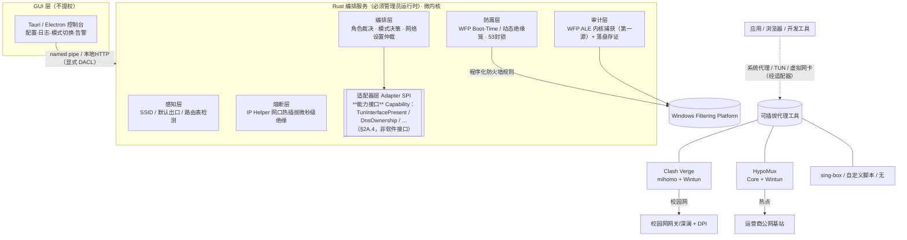
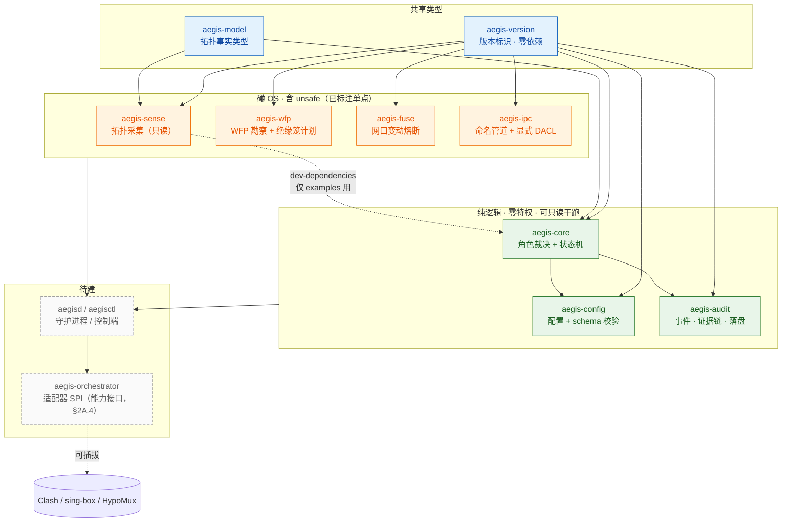
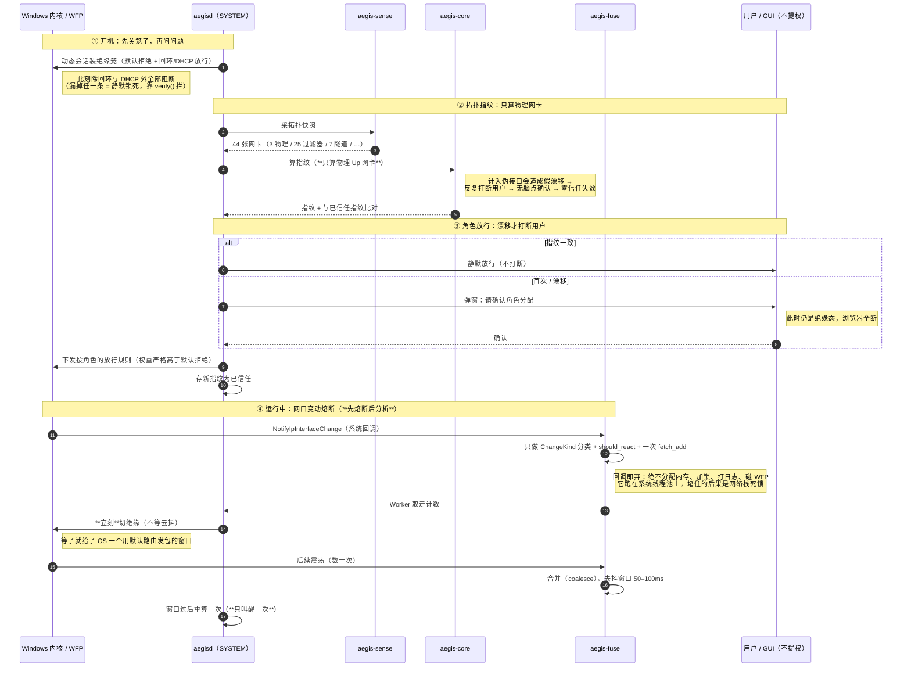

# 本地网络编排代理 · 设计与实施规划（v1.0 草案）

> 状态：方向确认 / 规划阶段  
> 平台：Windows 10 / 11（x64）  
> 目标形态：本地**编排 / 管控 / 审计守护进程**，不是新代理软件  
> 最后更新：2026-10-17

---

## 0. 一句话定位

本软件是一个**原生运行在 Windows 内核网络栈之上的编排管控守护进程（Orchestrator）**。它以 **WFP（含 Boot-Time 绝缘底座）为核心建立零信任绝缘底座**，内置内核级出站审计、物理网口微秒级熔断与网卡角色裁决；并通过**开放的适配器（Adapter SPI）**&#x517C;容接管 Clash Verge、HypoMux、sing-box 或任意自定义网络工具。底座（OS Level 网络安全）独立于任何上层代理软件（App Level），绝不与之强绑定。

---

## 1. 核心设计哲学（战略层）

| 原则              | 含义                                                               |
| --------------- | ---------------------------------------------------------------- |
| **明暗博弈 · 零信任**  | 默认校园网网关（深澜认证 + 深信服/锐捷等 DPI）对出站包做全量深度检测、行为审计与特征提取。不信任任何"能否穿透"的侥幸。 |
| **源头阻断优于事后补救**  | 在数据包离开本机前，于本地彻底掐断风险连接；不赌协议穿透。                                    |
| **物理 / 策略双轨分流** | 校园网通道 = "纯洁通道"（纯白名单、合规流量）；移动热点通道 = "自由出海通道"（物理级绕开校园网认证与审计）。      |
| **不碰网关漏洞**      | 不利用深澜等系统的未授权漏洞；即便能绕过认证，出口 DPI 仍会审计。本地白名单 + 物理热点隔离是成本最优解。         |

---

## 2. 被管控对象调研（已核实 · 现为"默认适配器实现参考"）

> **定位降级说明（架构解耦后）**：本节不再是强绑定前提，而是"Clash Verge / HypoMux 默认适配器（Default Adapter Implementation）"的接口参考。底座（WFP/审计/熔断）不依赖本节任何工具；换用 sing-box / v2rayA / 自写脚本时，只需新增一个适配器实现并在 TOML 切换 `proxy_provider`（详见 §2A）。

### 2.1 Clash Verge（= mihomo 内核 + Wintun TUN + 规则路由）

- 自带**标准 REST 控制 API**（默认 `127.0.0.1:9090`，鉴权 `Authorization: Bearer <secret>`）。
- TUN 开关 / 系统代理开关由 `clash-verge-service` 后台管理（公开文档弱于内核 API）。

**主控制面（内核 API 端点）：**

```text
GET    /connections        (或 ws 实时流)   → 审计日志源：源IP/目的IP/host/进程/命中规则/协议
DELETE /connections/{id}                     → 立刻掐掉违规连接（= 本地 REJECT 的执行点）
PATCH  /configs                            → 切 mode(rule/global/direct)、改端口
PUT    /proxies/{name}                     → 强制选中代理组/节点（校园网锁 DIRECT 或国内组）
PUT    /providers/rules/{name}             → 热替换规则集（校园网=纯国内白名单；热点=全规则）
GET    /rules  ·  GET /dns/query           → 规则与 DNS 取证
POST   /restart                              → 重载内核（用于 TUN/系统代理切换兜底）
```

### 2.2 HypoMux（Go + Wails，Windows 多网卡聚合工具，AGPL-3.0）

- 架构：桌面 GUI（无管理员常驻）+ 独立 **Core 服务（管理员权限）**。
- 两种模式：
  - **系统代理模式**：本地起 HTTP(10801)/SOCKS5(10800)，接管 Windows 系统代理。
  - **虚拟网卡模式**：Wintun + sing-box + WFP 捕获系统流量，按进程/域名/IP 分流。
- **无公开 REST API**（不像 Clash）。"接管"以**监管**为主：
  - 进程/服务启停（SCM 管 `HypoMux Core` 服务）；
  - 配置文件读写（路由、参与网卡、模式——开源格式可读）；
  - 端口协调（它占用的 10800/10801 或虚拟网卡由编排器决定何时上岗）。

---

## 2A. 架构解耦：原生网络安全总线 + 可插拔适配器（Pluggable Adapter Pattern）

> 核心洞察（来自架构评审）：网络安全、网卡绝缘、开机防漏、出站审计是**操作系统网络栈的事（OS Level）**；代理软件只是上层跑的**普通用户态进程（App Level）**。底座绝不能被上层工具绑架——否则 mihomo 改 REST 端点、HypoMux 调整 Core 架构、或换成 sing-box/v2rayA/自写脚本时，整个编排器会瞬间瘫痪。

### 2A.1 解耦对比

```text
【改造前：强耦合（脆弱）】
  编排器 ──(硬编码 API)──► Clash Verge ──(硬依赖)──► 审计依赖其 /connections
        ──(硬编码 SCM)──► HypoMux     ──(硬依赖)──► 强依赖其 10800 端口

【改造后：微内核 + 插件适配器（高内聚、零死绑）】
        ┌──────────────────────────────────────────────┐
        │        编排器微内核 (Core Engine)             │
        │  • WFP Boot-Time / 动态绝缘笼 (内核级)        │
        │  • 原生内核级出站连接审计 (基于 WFP ALE)      │
        │  • 物理网口热插拔微秒级熔断 (IP Helper)       │
        │  • 网卡角色裁决与系统网络设置仲裁            │
        └──────────────┬───────────────────────────────┘
                       │ (标准抽象 Trait / 适配器层)
      ┌────────────────┼────────────────────┐
      ▼                ▼                    ▼
 [标准/通用适配器]  [Clash/mihomo 适配器]  [sing-box / 自定义脚本]
 • 纯系统代理(PAC/IP) • REST API + ws 遥测  • 外部 CLI 启停
 • 无需任何特定软件  • 规则集热替换        • 自定义 Webhook 联动
 • 裸奔也能防漏      • 元数据富化          • 任意新工具开箱即用
```

### 2A.2 三大解耦落地

**① 审计彻底独立（收归 WFP 原生层）**

- **第一审计源（内核真理层）**：编排服务直接在 WFP 订阅 `FWPM_LAYER_ALE_AUTH_CONNECT_V4/V6`，任何进程、任何协议、走哪张物理网卡、目的 IP/端口，在**内核建连瞬间 100% 捕获入库**。哪怕机器上**一个代理都没装**，审计依然完整。
- **第二审计源（可选元数据富化）**：若当前配置了某适配器（如 Clash），异步拉取"域名/节点名"富化到内核审计表；拉不到**不影响基本审计**。
- → 这把 §12 F3 / §25 的审计模型从"依赖 Clash `/connections`"升级为"WFP 原生为主、适配器元数据为辅"。

**② 抽象出通用驱动 Trait（微内核只与抽象对话）**

```rust
// 1. 代理管理适配器（负责代理软件的运行与规则）
pub trait ProxyAdapter: Send + Sync {
    fn name(&self) -> &'static str;
    fn on_mode_change(&self, mode: NetworkMode) -> Result<()>;
    fn lock_system_proxy(&self, disabled: bool) -> Result<()>;
    // 可选能力：若该工具没有 API，返回 None 即可
    fn fetch_extra_telemetry(&self) -> Option<Vec<ConnectionMeta>> { None }
}

// 2. 多网卡/聚合适配器（负责多 WAN 叠加）
pub trait MultiWanAdapter: Send + Sync {
    fn name(&self) -> &'static str;
    fn bind_interface(&self, luid: u64, role: InterfaceRole) -> Result<()>;
    fn suspend_all(&self) -> Result<()>;
}

// 3. 审计富化适配器（可选，第二审计源）
pub trait AuditEnricher: Send + Sync {
    fn name(&self) -> &'static str;
    // 返回 (连接指纹→域名/节点) 映射，用于富化 WFP 内核审计表
    fn enrich(&self) -> Option<Vec<ConnectionMeta>> { None }
}
```

**③ 配置化注入（换工具只改 TOML）**

```toml
[orchestrator]
# 模式可选: "generic", "clash_verge", "sing_box", "command_hooks", "none"
proxy_provider    = "clash_verge"
multiwan_provider = "hypomux"

# 模式 A: 专用高性能扩展（当前环境）
[providers.clash_verge]
type         = "clash_rest"
api_base     = "http://127.0.0.1:9090"
secret       = "your_secret_here"
rule_campus  = "domestic-direct"
rule_free    = "full-outbound"

[providers.hypomux]
type         = "windows_service"
service_name = "HypoMuxCore"

# 模式 B: 未来换用 sing-box
[providers.sing_box]
type         = "singbox_experimental"
control_path = "\\\\.\\pipe\\sing-box-daemon"

# 模式 C: 终极通用 —— 命令钩子（任何能用 CLI 控制的工具都能驱动）
[providers.command_hooks]
type = "custom_exec"
on_campus_enter  = "powershell.exe -File C:\\Scripts\\switch_campus.ps1"
on_free_enter    = "powershell.exe -File C:\\Scripts\\switch_free.ps1"
on_airgap_locked = "taskkill /F /IM some_proxy.exe"

# 模式 D: 纯原生通用（不装任何代理，纯 WFP 物理网卡白名单隔离 + 防泄漏）
[providers.generic]
type = "native_system"
```

### 2A.3 绝对优势

- **版本升级无感**：Clash Verge 废弃/改名，WFP 绝缘笼、Boot-Time 防漏、网口熔断、出站存证照常运行；只需把 `proxy_provider` 设为 `generic` 或写个小脚本。
- **支持"纯净裸机"运行**：不需要出海时，关掉所有代理插件——编排器自身就是一个原生本地终端安全网关（Host-based Firewall & EDR）。
- **架构从"附庸"变"主宰"**：编排器不再是 Clash/HypoMux 的"看门狗"，而是操作系统"网络总督"；代理工具只是向它申请通道的租客，不守规矩或崩溃，总督直接焊死物理网卡。

### 2A.4 SPI 是**能力接口**，不是"软件接口"（重要修订）

> **为什么改**：§2A.2 那三个 trait（`ProxyAdapter` / `MultiWanAdapter` / `AuditEnricher`）
> 是按**软件类别**切的，方法名里带着"代理""多 WAN"这类词。换个软件就得改 trait，
> 而且 `Result<()>` 无法表达"这个能力我不支持"——失败与不支持混为一谈，
> 于是调用方要么假装成功，要么把所有失败都当成致命错误。
>
> 更根本的问题是：**没有任何 SPI 能保证适配所有软件**。Clash、sing-box、
> HypoMux、网卡融合工具的内部配置格式与生命周期差异太大，追求"确保适配"
> 只会被逼回源码内嵌。正确的目标不是"确保能适配"，而是
> **把不确定性显式化，并保证不适配时不漏流量**。

**① 改成能力枚举**

```rust
/// 适配器可以提供的**能力**，与具体软件无关。
pub enum Capability {
    TunInterfacePresent,     // 是否有 TUN / 虚拟网卡，且能被 Aegis 识别
    DefaultEgress,           // 能否接管默认出口
    ConfigFragmentGenerate,  // 能否产出配置片段（而非 Aegis 替它写全量配置）
    HealthProbe,             // 能否被健康检查
    Reload,                  // 能否热重载（不重启进程就让配置生效）
    DnsOwnership,            // 它是否接管 DNS（与 Aegis 的 53 封锁是否冲突）
}

pub trait Adapter: Send + Sync {
    fn name(&self) -> &'static str;
    /// **声明**支持哪些能力。Aegis 只使用双方都声明的能力。
    fn capabilities(&self) -> &[Capability];
    /// 真正做事。未声明的能力调用即 `Err(Unsupported)`，不是"失败"。
    fn invoke(&self, op: Op<'_>) -> Result<Outcome, AdapterError>;
}

pub enum AdapterError {
    /// 我没声明过这个能力 —— **不是故障**，是契约信息
    Unsupported(Capability),
    /// 声明了但做失败了 —— 这才是故障
    Failed { capability: Capability, reason: String },
    /// 做了，但结果违反 Aegis 的安全不变量
    InvariantViolation { .. },
}
```

`Unsupported` 与 `Failed` 必须分开：前者是启动期就能知道的静态事实，
后者是运行期的偶发故障。混在一起会让"Aegis 一直在重试一个永远不可能成功
的能力"，也会让"真的挂了"被当成"本来就不支持"而静默吞掉。

**② 能力矩阵与逐能力的失败模式（必须预先定死，不能运行时再选）**

启动时问每个适配器"你支持哪些能力"，不支持的明确标记 `Unsupported`。
**每个能力缺失时该怎么办，必须在代码里写死，不能笼统说"走保守策略"**——
"Fail-Closed 或告警"这个二选一一旦留给运行时判断，就会出现
"本该断网的时候只是弹了个提示"这种致命的摇摆。

| 能力 | 缺失时的处置 | 理由 |
|---|---|---|
| `DnsOwnership` | **Fail-Closed**：拒绝放行该出口 | 不知道谁管 DNS，就可能出现绕过 53 封锁的直连 DNS 泄漏 |
| `TunInterfacePresent` | **Fail-Closed**：不认为该出口可用 | TUN 没起来却以为起来了 = 流量走物理网卡直连，正是要防的事 |
| `DefaultEgress` | **Fail-Closed** | 无法接管出口就等于没有绝缘 |
| `Reload` | **告警 + 降级为重启** | 只是切换慢一点，不漏流量 |
| `HealthProbe` | **告警 + 继续** | 少一个健康检查，不等于有泄漏 |
| `ConfigFragmentGenerate` | **告警 + 只用 Aegis 自带的粗粒度规则** | 精细路由没了，但粗粒度封锁（53/广播/默认拒绝）仍在 |

**③ 能力声明 ≠ 能力事实**

适配器自己说"我支持 `Reload`"，不代表真的支持。声明必须由两件事验证：

- **fixture 契约测试**：先选 1 个参考适配器（建议 sing-box）与 1 个网卡场景，
  把输入/输出固化成 fixture。以后每个新适配器跑**同一组** fixture，
  这就是"适配"的可验证定义——适配不再是形容词，而是"这组 fixture 过没过"。
- **运行时能力自检**：声称支持某能力，就在启动后真的试一次
  （如声称 `Reload`，就做一次无害的 reload 看配置版本号是否变化）。
  声明与事实不符 = 适配器在撒谎，必须报 `Failed` 而不是信它。

**④ 生成配置片段，而不是接管配置**

适配器输出"配置片段 + 静态检查结果"，由下游软件自己加载。
Aegis 只验证片段是否**违反安全不变量**，绝不解析对方的全部规则。
理由同上：解析对方的全部规则 = 依赖对方的内部格式 = 版本一升级就崩。

**⑤ "不适配"必须有明确的失败模式**

每一种不适配都要给**错误码 + 处置建议**，而不是含糊的"适配器错误"：

| 失败模式 | 错误码 | 处置建议 |
|---|---|---|
| 能力缺失 | `CAPABILITY_MISSING` | 换适配器，或接受降级（列出降级后果） |
| 配置冲突 | `FRAGMENT_CONFLICTS_INVARIANT` | 指出冲突的具体不变量，不改就拒绝下发 |
| TUN 网卡未被放行 | `TUN_NOT_PERMITTED` | TUN 不在放行列表里 → 流量会被默认拒绝吃掉 |
| DNS 所有权冲突 | `DNS_OWNERSHIP_CONFLICT` | 两边都要管 53 → 必然有一边静默失效 |

这比"看起来适配了但静默漏流量"安全得多。

### 2A.5 对既有章节的影响（修订清单）

| 既有章节             | 修订                                                                            |
| ---------------- | ----------------------------------------------------------------------------- |
| §0 定位            | 已改为"原生内核网络栈编排守护进程 + 可插拔适配器 SPI"                                               |
| §2 被管控对象调研       | 已降级为"默认适配器实现参考"，不再是强绑定前提                                                      |
| §12 F2/F3 审计     | 审计主源改为 WFP ALE 内核层；适配器元数据降为可选富化                                               |
| §25 审计 DB schema | `connections` 主源标注为 WFP 内核捕获；`dst_host`/节点名来自适配器富化（可空）                        |
| §22 配置 schema    | 新增 `proxy_provider` / `multiwan_provider` + `[providers.*]` 可插拔段（与本节 TOML 对齐） |

---

## 3. 总体架构（分层）



### 分层职责

1. **感知层（用户态）**：WMI + 路由表 + IP Helper 识别出口网卡 / SSID；拓扑指纹；规则热切换触发器。
2. **编排层**：网卡角色裁决、模式决策、系统网络设置（系统代理/路由）仲裁；通过**适配器 SPI** 与上层工具交互，不与特定软件强绑。
3. **防漏层**：WFP Boot-Time 底座 + 动态会话绝缘笼 + 物理 53 封锁（§20 / §20.8A）。
4. **审计层（WFP 原生，第一源）**：订阅 `FWPM_LAYER_ALE_AUTH_CONNECT_V4/V6`，内核建连瞬间 100% 捕获；适配器元数据（域名/节点）仅作可选富化（§2A）。
5. **熔断层**：`NotifyIpInterfaceChange` / `NotifyRouteChange2` 网口变动微秒级拉起绝缘笼。

> 底座（S1–S5）全部为 OS 网络栈能力，**不依赖任何代理软件**；Clash/HypoMux/sing-box 仅作为 `ADAPT` 节点的可插拔实现（§2A）。

### 3.1 组件依赖图（crate 级）

> 上图是**分层职责**，这张是**实际代码的依赖方向**。两者必须能对上——
> 对不上就说明架构在文档里、代码在别处。



**依赖方向铁律（务必保持）**

```text
aegis-version ──▶ 所有层
aegis-model   ──▶ aegis-sense（产出）、aegis-core / aegis-config（消费）
aegis-sense   ──▶ 只有"真要读 Win32"的层才碰它
```

⚠ **策略层（`aegis-core` / `aegis-config`）只依赖 `aegis-model`，绝不依赖
`aegis-sense`。** 曾为 3 个类型（`InterfaceInfo` / `InterfaceKind` /
`if_flags`）依赖了整个 sense，把 `windows` crate 拖进纯逻辑的依赖图：
增量构建从约 3s 涨到约 22s，且"策略层可在普通用户下只读干跑"这条硬约束
名存实亡——光编译就得先把 WFP 绑定编一遍。抽出 `aegis-model` 后：

| crate | 改前 | 改后 |
|---|---|---|
| aegis-core | 7.4–22.5s | **3.9s** |
| aegis-config | 13.8–16.3s | **3.6s** |
| aegis-sense | 6.7–14.9s | **3.6s** |

校验：`cargo tree -p aegis-core | grep -c windows` 应为 **0**。

**`unsafe` 的落点（每个 crate 最多一处，且都写在模块文档里）**

| crate | `unsafe` 在哪 | 为什么只有那里 |
|---|---|---|
| `aegis-sense` | 采集模块 | 读 Win32，只读不改 |
| `aegis-wfp` | `session.rs` | 只剩 FFI 胶水，翻译逻辑已拆成纯函数 |
| `aegis-fuse` | `watch.rs` | 回调只做一次 `fetch_add`，绝不分配/加锁/碰 WFP |
| `aegis-ipc` | `pipe.rs`（+ `token.rs` 的随机数） | 端点常量、帧、版本判定全零 Win32 |
| `aegis-audit` | `store.rs`（写文件） | 事件/编码/链/导出全零 Win32，可完整单测 |

### 3.2 时序图：开机绝缘笼 → 拓扑指纹 → 角色放行 → 网口变动熔断



**四条不能改的顺序**

1. **先关笼子，再问问题**：反过来的话，问问题的那几秒里流量已经从默认路由出去了。
2. **指纹只算物理网卡**：见上图注释，假漂移的危害与假警报同类。
3. **熔断不等去抖**：第一个事件立刻切，重活等窗口过后做一次。
4. **放行权重必须严格高于默认拒绝**：否则放行被静默吃掉，表现为"配了却不通"。

---

## 4. 是否需要驱动级？（结论）

| 想做的事              | 是否要自写驱动       | 实际手段                                                                                                                    |
| ----------------- | ------------- | ----------------------------------------------------------------------------------------------------------------------- |
| 抓包 / TUN / 路由     | **否**         | Clash/HypoMux 已用 Wintun（已签名），直接复用                                                                                       |
| 白名单 REJECT（本地掐握手） | **否**         | **前置阻断**：Clash 规则 `FINAL,REJECT` + WFP ALE 出站过滤在驱动层 DROP（包离开真实网卡前）；`DELETE /connections/{id}` 仅作**只读审计后的兜底清理**，绝不承担首道防线 |
| 防漏 / kill-switch  | **否（但调内核策略）** | **WFP 动态会话**（`FWPM_SESSION_FLAG_DYNAMIC`）程序化下发规则；进程崩溃/被强杀/断电时内核自动清空，**不依赖静态 netsh/永久规则**                                |
| DNS 幽灵泄漏防护        | **否**         | 校园网模式硬规则：**禁止真实物理网卡出站目的端口 53（UDP/TCP）**；DNS 强制圈定在 TUN 内或仅放行指定内网 DNS/DoH                                                 |
| HTTP 明文重定向警告页     | 仅此需小组件        | 见 §7，建议降级为"阻断+Toast"                                                                                                    |

**结论：全程不需要自己写内核驱动（.sys）。** 唯一"内核相关"动作是调用 **WFP / `HNetCfg.FwPolicy2` COM / `fwpuclnt`** 等 OS 现成接口下发防火墙策略——无 HVCI 签名地狱、无蓝屏风险。

---

## 5. 技术选型（后端 = Rust）

**运行形态**：Windows Service（持有管理员权限，承担所有特权操作）。

**推荐 crate：**

- `windows` —— WFP/防火墙 COM、WMI 读 SSID、SCM 管理服务。
- `reqwest` + `tokio-tungstenite` —— Clash REST + ws 实时连接流。
- `serde` / `serde_yaml` —— 读写 Clash 与 HypoMux 配置。
- `notify` —— 监听配置变更、兜底同步。
- `tokio` —— 异步调度。

**前端：** 推荐 **Tauri**（后端本就是 Rust，GUI 与引擎同语言、体积小、不打包 Chromium）；若团队更熟 React 三件套且要快速富界面，可用 **Electron + 本地 Rust 服务**（代价是体积与"壳里再套 Rust 子进程"的割裂）。GUI 只负责配置/日志/模式/告警。

---

## 6. 权限模型（⚠️ 运行时必须管理员）

> **关键点：本软件运行时必须获得管理员（ elevated ）权限。因为这是基础功能，后续所有高级能力都建立在这个提权基线上。**

- **GUI（普通用户权限，不提权）**：只与后端服务通信，绝不直接做特权操作。
- **Rust 编排服务（管理员权限，常以 `NT AUTHORITY\SYSTEM` 运行）**：
  - 读 SSID / 管理路由表；
  - **WFP 动态会话（`FWPM_SESSION_FLAG_DYNAMIC`）下发防火墙/kill-switch 规则**——进程异常退出、被强杀、断电时，Windows 内核自动瞬时清空该会话注入的全部过滤规则，天然防呆熔断，无需复杂快照回滚；
  - 启停 `HypoMux Core` 等服务（SCM）；
  - 调用 Clash API、读写配置。
- **通信（Named Pipe ACL 陷阱）**：GUI ↔ 服务 走 **named pipe / 本地 HTTP**（localhost）。**注意**：`SYSTEM` 创建的 Named Pipe 默认拒绝标准用户连接；必须在 `CreateNamedPipeW` 时显式提供 `SECURITY_ATTRIBUTES`，构建允许当前登录用户 / `Authenticated Users` 读写的 DACL，否则非提权 Tauri 前端会 `Access Denied` 握不上手。

> 设计约束（与 HypoMux 最小权限理念一致）：提权只集中在后端服务，GUI 长期以普通用户运行。**还原保护以 WFP 动态会话为基线**——防火墙/kill-switch 规则进程死亡即被内核清空，杜绝静态规则残留导致重启后瘫痪；仅对**非 WFP 项**（系统代理、路由表）保留退出/崩溃时的快照还原逻辑作为补充。

---

## 7. HTTP 明文告警的务实方案

> **修正（架构体检 #1）**：明文阻断**绝不能**靠异步 `DELETE /connections/{id}`——等到 WS 遥测解析出该连接时，TCP 握手包 / HTTP GET 已物理飞出网卡，DPI 仅凭一个明文报文就完成特征标记，事后掐断只关本机 Socket，网关侧已越界。

因本软件不是代理本身，硬做"重定向到本地警告页"需上本地透明代理（额外组件）。**阻断必须前置到内核/协议栈层**：

- **前置阻断（首道防线）**：校园网模式下，对明文 80 端口（或非 TLS）流量在**离开真实网卡前**即拦截——靠 Clash 规则文件将相应目的 DROP/REJECT，或靠 WFP ALE 出站过滤在驱动层 DROP。包根本不离开本机。
- **Toast 仅作通知**：检测到明文连接被前置阻断后，弹 **Toast："检测到校园网明文连接，已阻断"**；`/connections` 的 `DELETE` 只作为审计后的兜底清理，**不**承担阻断首道防线。
- **可选升级**：若确需"重定向到本地警告页"的交互，再单独加一个监听 80 的本地小服务做重定向——这是唯一可能要补"包级小组件"的地方，列为 v2。

---

## 8. 双模式策略与冲突协调

**核心冲突**：Clash Verge 的 TUN 与 HypoMux 的虚拟网卡模式都会全局抓包，二者不能同时当"唯一捕获者"。编排器必须定义**独占 / 分层策略**。

| 场景          | Clash Verge                     | HypoMux                       | 防火墙 kill-switch             |
| ----------- | ------------------------------- | ----------------------------- | --------------------------- |
| **校园网严格模式** | TUN 开，灌**纯国内白名单规则集**，非国内 REJECT | **关闭**（避免聚合把流量漏到校园网关）         | 启用：除 Clash TUN 出口外，禁止直连真实网卡 |
| **热点自由模式**  | TUN 开，灌**全规则集**，自由出海            | 可选开**系统代理模式**做多链路带宽聚合（不抢全局捕获） | 关闭或仅基础防护                    |


> 协调要点：**同一时刻只有一个工具占全局捕获层**。HypoMux 在热点模式用"系统代理模式"而非"虚拟网卡模式"，不与 Clash TUN 冲突，还能给下载类应用叠加带宽。

> **系统代理注册表仲裁（架构体检 #4）**：Windows 系统代理在注册表 `HKCU\Software\Microsoft\Windows\CurrentVersion\Internet Settings\ProxyServer` **全局唯一**。编排器必须作为代理状态的**绝对仲裁者**——一旦进入热点聚合模式，通过 API **强制锁死 Clash Verge 的系统代理开关为关闭（仅留 TUN）**，避免 HypoMux 改写 `127.0.0.1:10801` 后两者轮流抢写注册表导致流量闭环错乱。

---

## 9. 实施路线图（MVP → 进阶）

**阶段 0 · 权限与骨架**
- [ ] Windows Service 宿主 + 管理员自启动/提权逻辑（UAC / 服务安装）
- [ ] GUI（Tauri）↔ 服务 named pipe 通信骨架
- [ ] 网络设置变更前的快照 + 退出还原机制（防断网残留）

**阶段 1 · 感知 + Clash 接管（核心）**
- [ ] SSID / 默认出口 / 路由表检测（WMI）
- [ ] Clash API 接入：读 `/connections` 审计、PATCH `/configs`、`PUT /providers/rules` 两套规则集
- [ ] 校园网/热点规则热切换

**阶段 2 · 防漏兜底**
- [ ] 校园网模式下程序化下发 WFP/防火墙规则（kill-switch）
- [ ] 规则/代理异常时的自动回滚

**阶段 3 · HypoMux 监管**
- [ ] SCM 启停 `HypoMux Core` 服务
- [ ] 配置读写 + 端口协调（系统代理 vs 虚拟网卡模式切换）
- [ ] 与 Clash 的独占/分层仲裁

**阶段 4 · 审计与告警**
- [ ] 全量出站日志落盘（DNS/IP/端口/协议/进程/规则/时间）
- [ ] 明文 80 连接阻断 + Toast 告警
- [ ] 证据链导出（被询问时可自证清白）

**阶段 5 ·（可选）高级**
- [ ] 本地 80 重定向警告页
- [ ] 流量噪声/混淆协调（镜像拉取、包管理更新等背景流）
- [ ] 规则集可视化编辑

---

## 10. 风险与开放问题

- **Clash Verge service API 不透明**：TUN/系统代理切换优先走"写配置 + 触发重载/重启"，需实测不同版本行为。
- **HypoMux 无流表 API**：其监控只能到进程/端口层级，细粒度审计依赖 Clash 侧。
- **双捕获层互斥**：必须严格仲裁，避免两个全局捕获同时开启导致环路或漏包。
- **管理员权限攻击面**：服务暴露的本地通道需鉴权，防止本机恶意软件借势改防火墙/路由。
- **合规边界**：本工具仅作用于用户自有设备的本地策略与审计；不提供绕过机构安全管控的越权手段。

---

## 11. 下一步可交付物（待确认）

1. **组件依赖图 + 时序图**（SSID 触发 → 规则集切换 → kill-switch 联动）。
2. **Rust 最小骨架**：调用 Clash API + WFP 防火墙规则下发的可运行示例。
3. **规则集模板**：校园网纯国内白名单 / 热点全规则 两套 YAML。

---

## 12. 功能设计总览

> 本章为**功能设计（Functional Design）**，在 §3 架构之上细化用户可见能力与数据来源。核心数据源：Clash REST API（`/traffic`、`/connections` ws、`/proxies`、`/rules`、`/providers/*`、`/dns/query`、`/configs`）+ Windows 网络接口计数器（自采 per-adapter 吞吐）+ HypoMux 配置/进程（监管）。

### 12.0 范围刹车：「监测」与「截住/放出去」是两件事（必读）

> **这条是防止项目跑偏的Stop线。** 常说"盾要监测所有流量，下游该干啥干啥，
> 上游把包截住还是放出去是另一回事"——这个区分是对的，但**必须分档**，
> 否则"监测所有流量"会被理解成全量包捕获，那是个无底洞。

**关键认知：在 WFP 里做全量包捕获成本极高**，需要 callout 驱动或
`FWPM_LAYER_*` 的包级订阅，性能与稳定性代价都大。分三档，**先做前两档**：

| 档 | 内容 | 何时做 | 成本 |
|---|---|---|---|
| **① 事件级审计** | ALE 层枚举出站**建连事件**（进程归属、目标地址、端口、网卡），做存证与统计 | **先做** | 低：事件流，不是包流 |
| **② 关键协议阻断** | 只对 53 / LLMNR / mDNS 广播等**少数高价值目标**做阻断，不碰普通流量 | **先做** | 低：少量静态规则 |
| **③ 全量裁决 / 截包** | 对每个包决定放不放 | **后做**，且需先证明 ①② 已闭环 | 高：callout 或驱动 |

先证明「事件级审计 + `cage_plan()` / `verify()`」能闭环，再谈第 ③ 档。

> ⚠ 别把 ① 的"审计"当成"监测所有流量"：ALE 事件是**建连事件**，
> 不是全量包，抓不到 payload。这够回答"谁在出站、有没有漏"，
> 但**回答不了"传了什么"**。需要 payload 是另一档能力，别混。

**Aegis 出的是裁决，不是转发。** Aegis 对每个连接返回
`permit` / `block` / `audit` 这样的**裁决动作**，下游继续做路由与代理；
Aegis 不碰 NAT、不碰代理链、不做转发。这样职责清晰，
也避免和下游抢流量——抢流量的结果是两边的规则互相打架，
而打架的表现是"时通时不通"，几乎无法排查。

---

| 模块 | 功能 | 主要数据源 |
|---|---|---|
| **F1 总览仪表盘** | 模式/接口/捕获工具状态、总吞吐、快捷开关 | 感知层 + Clash `/traffic` |
| **F2 实时流量监控** | 实时连接表、吞吐曲线、协议/域名分布、每网卡遥测大屏 | Clash `/connections` ws + Windows 计数器 |
| **F3 审计与存证** | 全量出站日志、阻断/明文视图、证据导出 | Clash `/connections` + 本地落盘 |
| **F4 配置与规则读取/治理** | 完整读取并展示 Clash & HypoMux 配置规则、差异对比、写回 | 两程序配置文件 + API |
| **F5 双模式编排控制** | 模式定义/切换/自动触发、策略包、切换预览 | 编排层 |
| **F6 防漏与安全** | kill-switch 面板、泄漏检测、快照还原 | WFP/防火墙 + 路由表 |
| **F7 告警与通知** | Toast、告警中心 | 各层事件 |
| **F8 统计与分析** | 时间/应用/地域维度聚合、报表导出 | 审计库聚合 |
| **F9 设置** | 服务/自启/日志/保留期/导出 | 配置 |

---

## 13. 功能模块详述

### F1 · 总览仪表盘（Dashboard）
- **状态卡**：当前模式（校园网严格 / 热点自由）、当前出口接口（SSID / 网卡名）、当前全局捕获者（Clash TUN / HypoMux / 无）、管理员权限状态、服务运行态、还原保护状态。
- **总吞吐卡**：实时上行/下行速率（来自 Clash `/traffic`，单位自动 kbps→Mbps）。
- **快捷开关**：模式切换、kill-switch 启停、Clash/HypoMux 启停、自动切换开关。
- **异常提示条**：检测到泄漏 / 明文阻断 / 服务异常时高亮。

### F2 · 实时流量监控（Real-time Traffic）
- **实时连接表**（Clash `/connections` ws 推送，1s 刷新）：时间、进程（含路径）、源 IP:端口、目的 IP:端口、host、协议（TCP/UDP）、命中规则、上行/下行速率、状态、操作（掐断按钮 → `DELETE /connections/{id}`）。
- **实时图表**：
  - 吞吐曲线（上行/下行，折线）；
  - 协议分布（环形）；
  - TOP 进程 / TOP 域名（条形）。
- **过滤与排序**：按接口（校园网/热点）、进程、域名、规则、协议；支持搜索。
- **每网卡遥测大屏**（复刻 HypoMux "五列实时遥测"风格）：网卡别名、IPv4、实时速率、连接数、聚合吞吐——数据由 **Rust 经 Windows 网络接口计数器（WMI `Win32_PerfFormattedData_Tcpip_NetworkInterface` 或 `GetIfTable`）自采**，绕开 HypoMux 无 API 的限制。
- **连接详情抽屉**：完整元数据、内外网判定（国内/海外）、路由路径、一键掐断。

### F3 · 审计与存证（Audit & Evidence）
- **全量出站连接日志**（持久化）：时间戳、进程路径、源/目的 IP:端口、host、协议、命中规则、所属接口（校园网/热点）、动作（allow / reject / firewall-block / plaintext-block）。
- **审计视图**：
  - 会话时间线 / 列表；
  - 域名排行 / IP 排行 / 进程排行；
  - **被阻断记录**专视图（REJECT + 防火墙拦截）；
  - **明文 HTTP(80)** 记录专视图。
- **检索与筛选**：时间范围、进程、域名、动作、接口。
- **证据导出**：导出 CSV / JSON 证据包（被网络中心询问时自证"无违规连接、阻断均发生在本地"）。
- **防篡改（可选）**：日志本地哈希 + 只读归档。

### F4 · 配置与规则读取 / 治理（Config & Rule）
- **Clash Verge 读取与展示**：
  - 完整 `config.yaml`：代理组、规则、TUN、DNS、fakeip、Mixe-port；
  - 订阅 providers、节点列表与延迟；
  - 规则集（ruleset）内容可视化（顺序 + 命中说明）；
  - 当前生效规则 vs 校园网/热点预设规则集的**差异对比**。
- **HypoMux 读取与展示**：
  - 参与网卡列表、当前模式（系统代理 / 虚拟网卡）、路由规则（进程/域名/IP-CIDR）、代理端口（10800/10801）；
  - 配置治理：编辑模式 / 参与网卡 / 规则 → 写回 + 触发重载（SCM 重启 Core 或发信号）。
- **统一配置视图**：分页/分栏展示两程序配置，附术语映射（如 Clash 规则 ↔ HypoMux 路由规则）。

### F5 · 双模式编排控制（Mode Orchestration）
- **模式定义**：校园网严格 / 热点自由，每个模式绑定一个"策略包"：
  - 关联 Clash 规则集（`PUT /providers/rules`）、节点锁定（`PUT /proxies/{name}`）；
  - HypoMux 开关与模式；
  - 防火墙 kill-switch 开关。
- **切换方式**：手动 + 自动（SSID/网卡名触发，见 §8）。
- **切换预览**：切换前展示"将发生的变更清单"（规则集、节点、HypoMux 状态、防火墙规则），确认后执行。
- **自动规则**：SSID 白/黑名单、网卡名匹配、优先级。

### F6 · 防漏与安全（Leak Prevention）
- **kill-switch 面板**：展示当前生效的 WFP/防火墙规则摘要（允许出口、阻断出口）。**规则一律通过 WFP 动态会话（`FWPM_SESSION_FLAG_DYNAMIC`）下发**，进程死亡内核自动清空（架构体检 #3）。
- **DNS 幽灵泄漏防护（架构体检 #2）**：校园网模式硬规则——**禁止真实物理网卡出站目的端口 53（UDP/TCP）**；所有 DNS 强制圈定在 TUN 内或仅放行指定内网 DNS/DoH，杜绝 Smart Multi-Homed Name Resolution 把敏感域名解析发往校园网 10.x DNS。
- **泄漏检测**：扫描是否有进程直连真实网卡（绕过 Clash TUN）——基于路由表 + 连接归属判断，异常即告警并可选自动阻断。
- **网络设置快照 / 还原**：展示快照内容，提供手动还原按钮；WFP 项由动态会话自动还原，仅非 WFP 项（系统代理、路由）走快照还原。

### F7 · 告警与通知（Alerts）
- **Toast/通知**：明文 HTTP 阻断、泄漏检测、模式切换、服务/权限异常。
- **告警中心**：历史告警列表（时间、类型、对象、处理动作）。

### F8 · 统计与分析（Statistics & Analytics）
- 时间聚合：日/周流量、校园网 vs 热点占比；
- 应用维度：各进程流量占比；
- 地域维度：国内 vs 海外分布；
- 报表导出（CSV/图表）。

### F9 · 设置（Settings）
- 服务/自启动状态、通信通道（named pipe）配置；
- 日志路径、轮转策略、数据保留期；
- 证据导出默认格式与路径；
- 外观（浅色/深色，对齐 HypoMux 主题切换）。

---

## 14. UI 设计指引（风格与布局）

**风格结论**：HypoMux 并非 Vue，而是 **Wails v3 + React + Fluent UI**（微软设计语言）。复刻其观感推荐 **Tauri + React + Fluent UI v9**（Rust 后端，技术家族一致）。若坚持 Vue，可用 Vue3 + 类 Fluent 组件库近似还原，但 React+Fluent UI 最忠实。

**布局草图（参考 HypoMux 风格：左侧导航 + 内容区 + 遥测大屏）：**
```text
┌──────────┬───────────────────────────────────────────────┐
│  Logo    │  总览仪表盘                                       │
│          ├───────────────────────────────────────────────┤
│ 总览     │  [模式:校园网严格] [接口:CMCC-EDU] [捕获:Clash TUN] │
│ 实时流量 │  上行 12.3 Mbps ↓  下行 48.1 Mbps ↑  活动连接 87   │
│ 审计     ├───────────────────────────────────────────────┤
│ 配置规则 │  每网卡遥测大屏（五列）：                          │
│ 编排     │  网卡 | IPv4 | 速率↓ | 速率↑ | 连接数             │
│ 防漏     │  WLAN | 10.x | 48.1M | 12.3M | 87               │
│ 告警     │  Eth  | 192. |  0   |  0   | 0  (被kill-switch)  │
│ 统计     ├───────────────────────────────────────────────┤
│ 设置     │  实时连接表（进程/目的/规则/速率/掐断）…            │
└──────────┴───────────────────────────────────────────────┘
```
- **主题**：浅色/深色切换（与 HypoMux 一致）。
- **组件库**：Fluent UI v9（Card、DataGrid、Donut/Bar chart、Toast、Drawer、Tabs）。
- **实时性**：仪表盘与连接表走 ws 推送 + 节流渲染；图表用轻量 SVG/Canvas。

---

## 15. 数据模型与存储

- **审计库**：SQLite（本地文件，按时间分区/轮转），表：`connections(...)``alerts(...)``snapshots(...)`。
- **配置缓存**：读取两程序配置后做结构化缓存（JSON），供 diff 与展示。
- **实时流**：内存环形缓冲（最近 N 条连接）+ 落盘审计；不长期驻留内存。
- **日志**：文本/JSON 结构化日志，带哈希归档选项。

---

## 16. 权限与运行形态（重申：管理员运行时是基线）

> **本软件运行时必须管理员（elevated）权限，因为这是基础功能，后续所有高级能力（防漏、配置治理、服务监管）都建立在该提权基线上。**

- **GUI（普通用户，不提权）**：仅与后端服务通信。
- **Rust 编排服务（常以 `NT AUTHORITY\SYSTEM` 运行）**：SSID/路由读取、**WFP 动态会话（`FWPM_SESSION_FLAG_DYNAMIC`）改写防火墙/kill-switch**、SCM 管 HypoMux Core、Clash API、配置读写、非 WFP 项的快照/还原。
- **通信安全（Named Pipe ACL，架构体检 #5）**：GUI↔服务 走 named pipe / 本地 HTTP；`SYSTEM` 创建的 Named Pipe 需显式 `SECURITY_ATTRIBUTES` DACL 放行 `Authenticated Users`/登录用户，否则非提权前端 `Access Denied`。
- **还原保护（WFP 动态会话为基线，架构体检 #3）**：防火墙/kill-switch 一律走 WFP 动态会话，进程死亡内核自动清空；仅系统代理、路由等非 WFP 项保留快照还原作为补充，杜绝静态规则残留导致重启后瘫痪。

---

## 17. 下一步可交付物（待确认）

1. **组件依赖图 + 时序图**（SSID 触发 → 规则集切换 → kill-switch 联动）。
2. **Rust 最小骨架**：调用 Clash API（`/traffic`、`/connections` ws）+ WFP 防火墙规则下发 + Windows 网卡计数器自采。
3. **规则集模板**：校园网纯国内白名单 / 热点全规则 两套 YAML。
4. **UI 原型**：Tauri + React + Fluent UI v9 的仪表盘 + 实时连接表 + 每网卡遥测大屏静态原型。

---

## 18. 架构体检：已识别隐患与修正（v1 评审）

> 来源：用户架构评审。以下 5 条均已**并入正文对应章节**（§4 / §6 / §7 / §8 / §16 / F6），此处保留为评审轨迹与验收清单。

| # | 隐患 | 原设计弱点 | 修正（已落地章节） | 验收点 |
|---|---|---|---|---|
| 1 | **致命时差**：`/connections` DELETE 挡不住 DPI | 异步 WS 遥测在握手包/Client Hello 飞出后才解析，事后掐断仅关本机 Socket | 阻断前置到内核：Clash `FINAL,REJECT` + WFP ALE 驱动层 DROP；`/connections` 仅只读审计（§4、§7） | 校园网模式下一握手包不得离开真实网卡 |
| 2 | **DNS 幽灵泄漏** | 未限物理网卡 53 端口，Smart Multi-Homed 会把敏感解析发往校园网 DNS | kill-switch 硬规则禁真实网卡出站 53（UDP/TCP），DNS 圈定 TUN/指定 DNS（§4、F6） | 校园网模式下物理网卡抓不到任何出站 53 包 |
| 3 | **崩溃永久断网** | 依赖退出/崩溃还原代码，蓝屏/taskkill/断电时残留静态规则 | 改用 **WFP 动态会话 `FWPM_SESSION_FLAG_DYNAMIC`**，进程死内核自动清空（§4、§6、§16、F6） | 强杀服务进程后防火墙规则瞬时消失、网络恢复 |
| 4 | **系统代理注册表冲突** | 热点模式 Clash TUN + HypoMux 系统代理抢写 `ProxyServer` | 编排器为绝对仲裁者：热点聚合模式强制锁死 Clash 系统代理为关（仅留 TUN）（§8） | 两程序不同时持有系统代理写权 |
| 5 | **Named Pipe ACL 陷阱** | SYSTEM 建 pipe 默认拒标准用户，非提权前端 `Access Denied` | `CreateNamedPipeW` 显式 `SECURITY_ATTRIBUTES` DACL 放行 `Authenticated Users`/登录用户（§6、§16） | 标准用户 Tauri 前端可连接 SYSTEM 服务 |

**原则收敛**：
- **阻断永远在包离开真实网卡之前**（Clash 规则 / WFP ALE），用户态异步只做审计与兜底。
- **所有特权网络策略走 WFP 动态会话**，不依赖任何"退出时还原"的假设。
- **编排器对共享资源（系统代理、捕获层）拥有唯一仲裁权**，避免多程序抢写。

---

## 20. 核心机制重构：Zero-Trust 网络层（四大硬核机制）

> 来源：用户架构重构提案。本重构把"按需 kill-switch"升级为**默认拒绝（Default-Deny）从开机起生效**的零信任网络层，是对 §4/§6/§8 安全模型的强化与泛化。

### 20.1 设计动机与总览
原方案在"已联网"前提下做策略切换，存在两个隐性信任：① 信任操作系统默认路由不会在策略生效前漏包；② 信任 kill-switch 能及时生效。重构后用**绝缘笼 + 拓扑指纹 + 角色模型**彻底反转：系统默认处于全网绝缘，只有"拓扑指纹吻合 + 用户确认角色"后才按角色精确放行。

```text
[开机自启 / 任意网口变动] → [WFP 注入绝缘笼 Cold-Boot Jail] → [五阶段前置自检]
   → (指纹吻合且已授权) 受控放行  /  (首次/漂移/未确认) GUI 强弹窗锁定
```

### 20.2 冷启动绝缘笼（Default-Deny Cold Boot）
- Windows Service（SYSTEM，auto-start）先于用户登录与任何应用启动；**首行代码即注入 WFP 全局封锁**（动态会话）。
- 仅两个放行破例（最小白名单）：
  - `127.0.0.1` 回环（GUI↔服务通信、Clash API 控制）；
  - `UDP 67/68` **DHCP 豁免（分层豁免，见 §28.1 / §27.4）**：**Boot-Time 持久层**放行条件只能用静态严苛条件——`接口类型 == 真实物理网卡` + `目的端口 67/68` + `目的地址 255.255.255.255（广播）`，**不允许匹配公网 IP + 67/68**（防借壳偷渡，也不依赖尚不存在的 Dhcp PID）；**运行期**守护解析到 Dhcp 服务 PID 后，在动态会话**覆盖下发带 PID 绑定的精细化 PERMIT**（§27.4）。
- 其余一切 TCP/UDP 在 `FWPM_LAYER_ALE_AUTH_CONNECT_V4` 层 DROP。Clash/HypoMux 即便自启动，物理网卡被焊死，连一个握手包都漏不出去。
- CampusStrict 阻断集额外封死 `UDP 5353/5355/137`（LLMNR/mDNS/NetBIOS 广播泄密，见 §27.2），避免 DNS 被拦截后系统向局域网广播敏感域名。

### 20.3 拓扑震荡即时熔断（Topology Shock Kill-Switch）
- 用 Windows IP Helper：`NotifyIpInterfaceChange` + `NotifyRouteChange2`（内核事件回调，非轮询）。
- **回调即弃（地雷三，§28.3）**：`raw_callback` 内部**严禁复杂逻辑**，只置一个无锁 `AtomicBool` 全局绝缘标志 / 向 Tokio channel 发 `Signal`。**去抖（Debounce 50–100ms）合并连续震荡**；首个变动事件触发瞬间，**仅做无锁微秒级全局阻断 Atomic 切换**（直接切到 Boot-Time 等价绝缘态），复杂的存量连接 RST、指纹重算、角色重灌全交**异步 Worker**——"先熔断、后分析"，杜绝同步重载导致的网络栈死锁。
- 任意接口 `Link Up/Down/IP Change` → 微秒级切回绝缘模式，GUI 置"待确认"，不给 OS 走默认路由发包的窗口期。
- **熔断必须叠加 §27 纵深加固**：① 立即 `GetExtendedTcpTable` + `SetTcpEntry(DELETE_TCB)` 强杀所有非白名单存量 `ESTABLISHED` 连接（死角一，ALE 层管不到已建立流）；② 在 `FWPM_LAYER_OUTBOUND_TRANSPORT_V4` 挂常驻 DROP（覆盖已建立流的数据包）；③ 监听 `RegisterSuspendResumeNotification`，`PBT_APMSUSPEND` 即时拉绝缘笼（死角三，防 Modern Standby 盒盖梦游）。


### 20.4 拓扑指纹防伪（Topology Fingerprint）
- 对所有 `Up` 状态网卡计算 SHA-256：
  `Fingerprint = SHA256( Σ (NET_LUID + MAC + SSID/Profile + Gateway_IP) )`
- 仅当"当前指纹 == 上次确认指纹"才自动恢复放行；任何断开/新插/换 Wi-Fi → 指纹改变 → 判定拓扑漂移 → 锁定。

### 20.5 网卡角色抽象模型（Role-Based Interfaces）
| 角色 | 定位 | WFP 底层策略 | 软件协同 |
|---|---|---|---|
| `Role::CampusStrict` | 校园网接入（有线/无线） | 锁死物理 53 端口；除国内直连白名单外物理阻断其余出站 | Clash 强灌国内纯白名单；关闭 HypoMux 该接口聚合 |
| `Role::FreeOutbound` | 热点/PCE/独立外网 | 开放直连出海；允许 Clash TUN 绑默认出口 | Clash 灌全规则出海集；作为主要出境通道 |
| `Role::Aggregated` | 仅供 HypoMux 叠加带宽的次级网卡 | 禁止普通应用访问，仅放行 HypoMux 核心进程收发 | 启动 HypoMux 接管该网卡叠加吞吐 |
| `Role::Isolated` | 未知/未配置/违规网卡 | WFP 绝对 DROP ALL | 两软件均不可向其发包 |

> 此模型把"双轨分流"泛化为**每网卡角色**，从根上消解 §8 的"全局捕获层互斥"——冲突不再是谁占全局代理，而是"每张网卡允许哪个进程/工具使用"。

> **白名单判定归属（地雷五，§28.5）**：`CampusStrict` 行中的"国内直连白名单"**不在 WFP 层平铺万级 CIDR**（性能崩、熔断秒级），而是**下沉给适配器**（mihomo/Clash TUN 以 radix tree 优化路由查找）。WFP 仅负责粗粒度防御（锁 53/广播/非认证端口 + 存量连接 `OUTBOUND_TRANSPORT_V4` DROP）；所有经适配器 TUN 出口的合规流量，由适配器内部完成白名单路由。若非要在 WFP 实现万级 CIDR，须用 `OUTBOUND_TRANSPORT_V4` + IP 集合（WFP Network Sets，Win10 1709+）而非平铺 Filter。

### 20.6 五阶段自检流水线（Preflight）
1. 环境检测 → 2. 系统拓扑采集 → 3. 两软件（Clash/HypoMux）健康度 → 4. 指纹比对 → 5. 授权确认。任一未通过即保持绝缘。
> 状态机落点见 §26：`Preflight` 之后按指纹/授权结果分流至 `PendingApproval` / `Controlled` / `Locked`；`Controlled/Locked` 下若探针检测到校园网未认证，进入临时 `CaptivePortal` 沙盒态（§27.6 / §29.2）；`Locked` 弹窗倒计时归零则进入 `TIMEOUT_FALLBACK` 超时降级分支（按 `timeout_action` 兜底，§29.4）。

### 20.7 Rust 实现骨架（已收录用户补丁）
**微秒级网口监听：**
```rust
// Cargo.toml: windows = { version = "0.58", features = ["Win32_NetworkManagement_IpHelper"] }
use std::ffi::c_void;
use windows::Win32::NetworkManagement::IpHelper::*;
use windows::Win32::Foundation::HANDLE;

pub struct InterfaceWatcher {
    notification_handle: HANDLE,
}

impl InterfaceWatcher {
    pub fn start_watching<F>(callback: F) -> windows::core::Result<Self>
    where
        F: Fn() + Send + 'static,
    {
        let boxed_callback = Box::new(callback);
        let mut notification_handle = HANDLE::default();

        unsafe extern "system" fn raw_callback(
            caller_context: *const c_void,
            _row: *const MIB_IPINTERFACE_ROW,
            _notification_type: MIB_NOTIFICATION_TYPE,
        ) {
            let closure = &*(caller_context as *const Box<dyn Fn()>);
            closure(); // 触发全网口阻断熔断
        }

        unsafe {
            NotifyIpInterfaceChange(
                windows::Win32::Networking::WinSock::AF_UNSPEC.0 as u16,
                Some(raw_callback),
                Some(Box::into_raw(boxed_callback) as *const c_void),
                false.into(),
                &mut notification_handle,
            )?;
        }

        Ok(Self { notification_handle })
    }
}
```
**冷启动 / 变更时的绝缘笼（WFP 默认拒绝）：**
```rust
impl WfpDynamicController {
    /// 注入"绝缘笼"：除 Localhost 与 DHCP 外，杀掉全系统所有网卡一切物理出站
    pub fn engage_airgap_jail(&self) -> windows::core::Result<()> {
        unsafe {
            // 1. 注入顶级优先级 DEFAULT_BLOCK (FWPM_LAYER_ALE_AUTH_CONNECT_V4)
            // 2. 注入 EXEMPT: 目的IP==127.0.0.1; 目的端口 67/68 且 UDP(DHCP)
            //    其余流量内核层 DROP，无需解析域名/进程
        }
        Ok(())
    }

    /// 用户确认角色后解除绝缘笼，按角色精确注入白名单
    pub fn release_jail_and_apply_roles(&self, interface_roles: &[InterfaceConfig]) -> windows::core::Result<()> {
        // 校园网卡 -> 白名单 + 禁53; 热点 -> 放行出海; 未分配 -> 保持绝缘
        Ok(())
    }
}
```

### 20.8 评审与待决问题（实现时需解决）
- **开机漏包窗口（已解决 → 见 §20.8A / §20.8B）**：SYSTEM 用户态服务的 WFP 注入虽早于登录应用，但晚于 TCP/IP 栈初始化。最终采用 **WFP Boot-Time Filter（`FWPM_FILTER_FLAG_BOOTTIME | PERSISTENT`）** 作为 fail-closed 背板：内核态早于 BFE 与任何用户态服务加载，封堵开机竞态漏包；与运行期动态会话分层（boot 兜底 + 动态放行），守护进程崩溃时动态会话自动清空、boot 底座仍 DENY。代码级 3 处修正见 §20.8B。
- **`Aggregated` 角色与 Clash TUN 路由冲突**：若某网卡为 `FreeOutbound`（Clash TUN 默认出口），另一张为 `Aggregated`（HypoMux 源绑定出口），Clash TUN 的默认路由可能把 HypoMux 的包也捕获进 TUN，形成环路/失效。需确保 HypoMux 源绑定网卡拥有**更具体的明示路由**或让 Clash TUN 对 HypoMux 进程/源 IP 放行，列为关键协调项。
- **回调内存**：骨架中 `Box::into_raw` 后未释放（泄漏一次）。长稳服务可接受，但建议在 `Unregister` 时回收该 Box。
- **`AF_UNSPEC.0 as u16`**：`AF_UNSPEC=0` 表示同时监听 IPv4/IPv6，逻辑正确；写法略绕，可改用 `0u16` 或 `AF_UNSPEC as u16` 更清晰。

### 20.8A 启动期与失效闭锁（Fail-Closed Boot-Time Backbone）—— 用户补丁

> 解决 §20.8 #1（开机漏包窗口）。**无需自写 `.sys` 驱动**：Windows 内核原生提供 WFP Boot-Time Filters。

**原理**：微软在 WFP 中提供 `FWPM_FILTER_FLAG_BOOTTIME` 标志。带此标志（并叠加 `FWPM_FILTER_FLAG_PERSISTENT`）的过滤器固化至注册表 `SYSTEM\CurrentControlSet\Services\BFE\Parameters\Policy\BootTime`，并由内核驱动 `fwpkclnt.sys` / `netio.sys` 在**内核加载阶段（驱动级，早于 BFE 服务与任何用户态服务）**直接装载。网卡 Link Up、IP 刚拿到的瞬间，内核出站钩子即丢弃除回环与 DHCP 外的所有出站包——NCSI 探测、Windows Update、自启后台的握手包在内核层全部 DROP，连网卡控制器都走不出去。

**Fail-Closed Lease（安全闭锁租约）模型（四期）：**
1. **冷启动期（无守护）**：系统完全受内核级 Boot-Time Filter 管控，全网绝缘。
2. **就位过渡期（租约建立）**：Rust 守护启动 → 五阶段自检 → 用户确认角色。
3. **受控放行期（租约维持）**：守护下发运行期（动态会话）高权重放行规则，覆盖 boot 阻断。
4. **失控保护期（租约断裂）**：守护被结束/崩溃/强杀 → 动态会话瞬时清空 → 由 boot 底座自动接管并全局断网（Fail-Closed），绝不给无管控直连的机会。

**Rust 实现骨架（用户补丁）：**
```rust
// Cargo.toml: windows = { version = "0.58", features = [
//   "Win32_NetworkManagement_WindowsFilteringPlatform", "Win32_Foundation"] }
use windows::core::*;
use windows::Win32::Foundation::*;
use windows::Win32::NetworkManagement::WindowsFilteringPlatform::*;

pub struct BootTimeIsolationEngine { engine_handle: HANDLE }

impl BootTimeIsolationEngine {
    pub fn new() -> Result<Self> {
        let mut engine_handle = HANDLE::default();
        unsafe {
            FwpmEngineOpen0(None, RPC_C_AUTHN_DEFAULT, None, None, &mut engine_handle)?;
        }
        Ok(Self { engine_handle })
    }

    /// 注入开机第 0 毫秒生效的驱动级绝缘过滤器
    pub fn install_boot_time_airgap(&self) -> Result<()> {
        unsafe {
            let mut filter = FWPM_FILTER0::default();
            filter.displayData.name = w!("AirGap_BootTime_DropAll");
            filter.displayData.description = w!("驱动级开机零时阻断：守护进程就位前禁止出站");
            // 关键标志：BOOTTIME 驱动级自加载 + PERSISTENT 持久化
            filter.flags = FWPM_FILTER_FLAG_BOOTTIME | FWPM_FILTER_FLAG_PERSISTENT;
            filter.layerKey = FWPM_LAYER_ALE_AUTH_CONNECT_V4;
            filter.action.r#type = FWP_ACTION_BLOCK;
            // 权重设为最底层兜底，运行期高权重白名单可覆盖
            filter.weight.r#type = FWP_UINT8;
            filter.weight.Anonymous.uint8 = 0;
            // （排除 Localhost / DHCP 的 PERMIT 需额外高权重过滤器，见 §20.8B）
            FwpmFilterAdd0(self.engine_handle, &filter, None, None)?;
            println!("已安装 WFP Boot-Time 驱动级开机绝缘背板。");
        }
        Ok(())
    }
}
```

### 20.8B Boot-Time 骨架代码级评审（实现前必读）

§20.8A 的骨架**机制方向完全正确**，但有 3 处致命/遗漏，直接照抄会导致"开机反而断网（连 DHCP 和回环都挡掉）"或"IPv6 泄漏"：

- **⚠️ 修正 1 — 排除规则根本没实现**：骨架里那条 BLOCK 过滤器**没有任何 `filterConditions`**，注释写的"允许 Localhost / 允许 DHCP"只是文字。WFP 单条 BLOCK 无法表达"排除例外"，必须**分层 permit-over-block**：在更高权重处额外添加两条 PERMIT 过滤器——
  - ① 目的 IP ∈ `127.0.0.0/8`（回环放行，供 GUI↔服务、Clash API）；
  - ② 协议 `UDP` 且目的端口 `67`/`68`（DHCP 放行，否则网卡拿不到 IP、GUI 无法展示状态）。**注意分层豁免（§28.1）**：此 Boot-Time 持久 PERMIT 只能用静态严苛条件——`接口类型 == 物理网卡` + `目的端口 67/68` + `目的地址 255.255.255.255（广播）`，**不得在此层要求 PID 匹配**（开机内核加载阶段 `svchost(Dhcp)` 进程尚未创建，强制 PID 会拿不到 IP 造成死锁）；运行期守护在动态会话中再覆盖下发**绑定 Dhcp 服务 PID**的精细化 PERMIT（§27.4）。
  若不做这两条 PERMIT，当前骨架会把 DHCP 和回环一起 DROP → 网卡无 IP、守护进程与 GUI 的回环通信也断。

- **⚠️ 修正 2 — 缺 IPv6 层**：骨架只挂在 `FWPM_LAYER_ALE_AUTH_CONNECT_V4`。现代 Windows 默认启用 IPv6（含临时地址、Teredo/6to4/ISATAP），仅靠 V4 阻断会让 IPv6 出站成为漏点。必须同时挂 `FWPM_LAYER_ALE_AUTH_CONNECT_V6` 的等价 boot-time 阻断（配同样的 PERMIT 例外）。

- **⚠️ 修正 3 — 生命周期与"禁用防护"路径缺失**：Boot-Time 过滤器是**一次性安装、持久驻留注册表**（仅在"初次安装/初始化"阶段 `FwpmFilterAdd0` 一次；后续开机由内核自动重载，守护进程**无需每次重加**）。因此必须定义明确的解除路径：仅当用户**显式关闭防护**时才 `FwpmFilterDeleteByKey0` 删除该底座；否则它应作为永久 fail-closed 背板一直存在（含正常关机/重启后依然阻断，直到守护进程接管放行）。若缺少显式禁用路径，用户将无法在"想正常裸连"时恢复网络——这是产品可用性硬需求。

- **💡 次要**：权重用 `FWP_UINT8 = 0` 作最底层兜底可行，显式用 `FWP_UINT64` 更直观；另建议给过滤器设置稳定 `filterKey`（GUID）并在安装前按 key 查重（`FwpmFilterGetByKey0`），避免重复安装产生冗余/冲突规则。

> 组合模型总结：**Boot-Time（weight 0 / PERSISTENT / V4+V6，含回环+DHCP 的更高权重 PERMIT）作 fail-closed 背板** + **运行期动态会话（`FWPM_SESSION_FLAG_DYNAMIC`）作高权重精细化放行/阻断**。守护进程存活且完成自检+角色确认时，动态规则覆盖 boot 底座；守护崩溃/被杀时，动态会话内核自动清空，boot 底座立即接管全局 DENY。两层叠加，开机零漏包与崩溃自动熔断同时达成。

### 20.9 交互体验（UX 闭环）
- 开机首次亮屏：Fluent 提示"安全隔离中：检测到 N 个网络接口，请确认角色分配"；此时浏览器全断（DNS/握手均不可），无漏包可能。
- 控制台逐网卡下拉分配角色 → 【应用并放行】。
- 日常使用中网线被拔/热点断开 → 微秒级拉起绝缘笼全断网 + 告警"拓扑震荡，流量已物理截断"。

### 20.10 规则模型：不变量层 + 可覆盖策略层（**不做全局优先级链**）

> **为什么不能用全局优先级链**：每一级用户都可能定制（Aegis / 网卡融合工具 /
> 代理规则 / 用户覆写），硬编码"Aegis > 网卡融合 > 代理"这种链，
> 用户一改就失效，而且 Aegis 会被拖去做"谁的优先级高"的仲裁——
> 那是无解的，因为每一层都有理由认为自己该赢。

正确模型是**两层**，且两层的性质根本不同：

#### 第一层：安全不变量（**不可覆盖**，是"宪法"）

这些不是"优先级最高"，而是**根本不参与规则引擎的排序**——
类似宪法不参与普通立法排序。任何来源的用户定制都不得覆盖它们：

| # | 不变量 | 违反后果 |
|---|---|---|
| 1 | 默认拒绝；放行必须显式，且权重**严格高于**拒绝 | 放行被静默吃掉，或笼子没关 |
| 2 | 回环放行、DHCP 放行必须存在且不被遮蔽 | 前者让用户失去唯一能拆笼子的界面；后者开机即永久锁死 |
| 3 | 物理网口对 53 / LLMNR / mDNS 广播的阻断 | 绕过适配器的直连 DNS 与广播泄漏 |
| 4 | 拓扑震荡时**先熔断、后分析** | 等去抖的这几十毫秒里漏包 |
| 5 | Boot-Time 持久规则默认关闭，启用必须显式确认 | 装错即变砖，且进程退出重启都清不掉 |

`aegis-wfp` 的 `verify()` / `verify_policy()` 只校验这一层。

#### 第二层：可覆盖策略（用户可定制）

网卡权重、路由度量、DNS 分配；代理策略组、规则匹配、分流；
Aegis 的审计规则、告警阈值、日志级别。

这一层可以有多级来源（全局 / 场景 / 应用 / 用户），用普通的
**来源优先级 + 显式覆盖**解决，**不需要 Aegis 去仲裁**。

#### Aegis 在这一层只做一件事

> **检查第二层产出的结果有没有违反第一层不变量。违反就拒绝下发或告警，
> 而不是替用户排序。**

这样每一级用户都能定制，但底线不变；Aegis 也不用维护一条必然失效的
全局链，只需要一个**不变量校验器**。

#### 代码落点（已实现）

`aegis-wfp::plan` 把结论按归属层分开，两者都阻止下发，但**报错语义不同**：

| `FindingKind` | 含义 | 例子 |
|---|---|---|
| `Invariant` | 第一层：底线没守住 | `LOOPBACK_MISSING` / `DHCP_MISSING` / `NO_DEFAULT_DENY` / `PERMIT_SHADOWED` |
| `Hygiene` | 第二层：写法错误，会静默失效 | `WEIGHT_OUT_OF_RANGE` / `DUPLICATE_WEIGHT` / `BOOT_CONDITION_NOT_STATIC` |

分开的意义是报错可信度：混为一谈会让用户把"权重写越界"误当成"我改了底线"
（从此不敢定制），也会把"底线没兑现"误当成"只是没写好"（从此不当回事）。

另有 `verify_policy(plan, policy)` 做**策略兑现对账**：`CagePolicy` 声明了什么，
`cage_plan()` 是不是真的产出了什么。它抓的是 `verify()` 的盲区——
把 `dns_lock` 关掉，计划照样自洽、照样"安全"，只是 DNS 不再被锁，
而用户从配置上看是"DNS 已锁"。**声明与产出脱节**是最阴的静默失败。
其中反方向最危险：`boot_backbone = false` 却产出 `Tier::Boot` 规则
（`UNDECLARED_BOOT_RULE`），等于 Aegis 悄悄往机器上留了清不掉的东西。

---

## 21. 下一步可交付物（待确认）

1. **组件依赖图 + 时序图**（开机绝缘笼 → 拓扑指纹 → 角色放行 → 网口变动熔断）。
2. **Rust 最小骨架**：Clash API + **WFP 动态会话绝缘笼 + 53 端口封锁** + **拓扑指纹(SHA-256)** + **`NotifyIpInterfaceChange` 网口熔断** + **Named Pipe 显式 DACL** + （可选）**Boot-Time 持久过滤器背板**。
3. **规则集模板**：校园网纯国内白名单（`FINAL,REJECT` 收尾）/ 热点全规则 两套 YAML。
4. **UI 原型**：Tauri + React + Fluent UI v9 的仪表盘 + 角色分配控制台 + 实时连接表 + 每网卡遥测大屏。
5. **角色模型与 Clash/HypoMux 协同矩阵**：明确四角色下两程序的启停、TUN/系统代理、路由归属。
6. **参考适配器 + fixture 契约测试**（§2A.4 ③）：先做 1 个参考适配器（建议 sing-box），把"适配"从形容词变成"这组 fixture 过没过"。

### 21.1 已落地进度（截至 2026-10-18）

| 项 | 状态 | 落点 |
|---|---|---|
| 感知层（拓扑 / 指纹 / 差分） | ✅ | `aegis-sense` |
| 角色裁决 + 状态机 | ✅ | `aegis-core` |
| WFP 只读勘察 + 持久背板审计 | ✅ | `aegis-wfp::session` |
| 绝缘笼规则计划 + 静态自检 | ✅ | `aegis-wfp::plan`（含 `verify` / `verify_policy`） |
| 拓扑震荡熔断（已接 FFI） | ✅ | `aegis-fuse` |
| Named Pipe + 显式 DACL + token 鉴权 | ✅ | `aegis-ipc` |
| 审计事件 + 证据链 + 只追加落盘 | ✅ | `aegis-audit`（**尚未接数据源**） |
| **真正下发 WFP 规则** | ⬜ 未做 | 需提权，且会改变本机网络状态 —— **必须先征求用户同意** |
| 证据导出（CSV/JSON 证据包） | ✅ | `aegis-audit::export`（CSV 防公式注入 + JSON 证据包） |
| 适配器 SPI（能力接口） | ✅ | `aegis-orchestrator`：`Capability` + 逐能力失败模式 + 能力矩阵 |
| 参考适配器 + 契约测试夹具 | ✅ | `aegis-orchestrator::reference` / `::contract`（§2A.4 ③） |
| 规则集模板（校园网 / 热点两套 YAML） | ⬜ 未做 | §21 第 3 项 |
| UI 原型（Tauri + Fluent UI v9） | ⬜ 未做 | §21 第 4 项 |

### 21.2 适配器 SPI 的三条判定（已落地）

接一个新适配器时，"适配好了没有"由三件事判定，**缺任何一件都不算**：

| 判定 | 验的是什么 | 不过的后果 |
|---|---|---|
| **契约**（`contract::check`） | 诚不诚实：声明了的能力真的做得到吗 | 声明与事实脱节 = 上层按"有这个能力"来用，实际没有 |
| **矩阵**（`spi::matrix`） | 够不够：有没有 Fail-Closed 缺口 | 诚实但能力不够 → 出口必须判不可用 |
| **自检**（`spi::audit_declaration`） | 声称支持的能力在真机上真的成立吗 | 装配期没暴露，运行期第一次调用才炸 |

⚠ **契约过 ≠ 能用。** 一个只声明了 `TunInterfacePresent` 的适配器，
契约可以一条不红（没声明的能力都老老实实回 `Unsupported`），
但矩阵会指出 `DefaultEgress` / `DnsOwnership` 两个 Fail-Closed 缺口，
出口仍然不可用。这两件事**必须分开看**——合成一个"通过/不通过"
就会把"诚实但能力不够"伪装成"适配好了"。

⚠ **自检有副作用，且这是故意的。** 声称支持 `Reload` 就必须真的 reload 一次，
否则"验证"只是又问了一遍"你支持吗"。副作用是配置版本会被推到新版本，
因此**自检必须排在契约之后**，否则契约里"健康检查报当前版本"这条会假红。

⚠ **范围约束见 §12.0**：只做「事件级审计」与「关键协议阻断」两档；
全量裁决 / 截包（第 ③ 档）**后做**，且需先证明前两档闭环。

---

## 22. 编排器自身配置与持久化 Schema

编排器需要一份**自己的**配置（与 Clash/HypoMux 的配置分离），存放接口角色分配、信任指纹、模式定义与审计参数。建议用 **TOML**（易读、强类型、Rust 一等支持）。

- **系统级配置**：`%PROGRAMDATA%\Orchestrator\config.toml`（SYSTEM 可写，GUI 只读）。
- **用户级偏好**：`%LOCALAPPDATA%\Orchestrator\prefs.toml`（普通用户可写，如主题、窗口布局）。

```toml
# config.toml —— 编排器主配置

[service]
auto_start        = true     # 注册为 Windows Service，SYSTEM 权限、auto 启动
pipe_name         = "orchestrator"   # \\.\pipe\orchestrator
ipc_fallback_port = 19827     # Named Pipe 不可用时的本地 HTTP 兜底端口
log_level         = "info"

# ── 救砖逃生通道（地雷二，§28.2）──
[rescue]
boot_time_filter_guid = "3f2a1c...-固定 GUID"  # 安装时生成并固化，rescue 工具按此 key 删除
watchdog_fail_threshold = 3   # 连续 N 次启动失败 → RunOnce 看门狗自动调 rescue 清除背板
rescue_key_combo = "Shift"    # 开机按住此键跳过装载 Boot-Time 背板（进入裸连排查态）
rescue_exe_path  = "C:\\Program Files\\Orchestrator\\orchestrator-rescue.exe"

# ── 可插拔适配器选择（§2A 解耦核心）──
# 底座（WFP/审计/熔断）与以下 provider 完全解耦；换工具只改这里
[orchestrator]
proxy_provider    = "clash_verge"   # generic | clash_verge | sing_box | command_hooks | none
multiwan_provider = "hypomux"       # hypomux | command_hooks | none

[topology]
# 上次用户确认过的信任指纹；空表示首次开机需分配
trusted_fingerprint = "a1b2c3...sha256"
last_confirmed_at   = "2025-10-17T09:24:00+08:00"
# 接口角色分配：键为稳定标识（优先 NET_LUID 字符串，回退 MAC）
[[topology.interface_roles]]
identity = "LUID:1689395631011611136"
role     = "CampusStrict"
[[topology.interface_roles]]
identity = "MAC:DEADBEEF0011"
role     = "FreeOutbound"

# 国内直连白名单（校园网模式），由当前 proxy_provider 适配器解释执行
[whitelist]
domestic_rule_set = "domestic-direct"   # 传给适配器的规则集键
allow_dns         = ["223.5.5.5", "119.29.29.29"]  # 仅允许这些 DNS（TUN 内或指定）

[audit]
db_path        = "%PROGRAMDATA%\\Orchestrator\\audit.db"
rotation_days  = 30
max_size_mb    = 512
export_formats = ["csv", "json"]

# 四角色的模式定义：rule_set 由活动 proxy 适配器解析；不绑定任何特定软件
[modes.CampusStrict]
rule_set            = "domestic-direct"   # 校园网纯国内白名单（适配器热替换）
system_proxy_lock   = "off"               # 编排器锁死系统代理（防抢注册表）
multiwan_on_this_if = false
dns_policy          = "tun-only"          # 物理 53 一律 DROP

[modes.FreeOutbound]
rule_set            = "full-outbound"     # 自由出海全规则
system_proxy_lock   = "off"
multiwan_on_this_if = false   # 仅当另有 Aggregated 卡时才启用
dns_policy          = "tun-or-spec"

[modes.Aggregated]
clash_tun_exclude   = true    # 若活动代理为 TUN 类，须排除该卡源（§24 铁律3）
multiwan_on_this_if = true
multiwan_mode       = "src-bind"   # 源绑定，不抢全局捕获

[modes.Isolated]
all_drop = true

# ── 可插拔 Provider 实现（新增工具只需加一段，实现对应 Trait）──
[providers.clash_verge]
type         = "clash_rest"
api_base     = "http://127.0.0.1:9090"
secret       = "your_secret_here"
rule_campus  = "domestic-direct"
rule_free    = "full-outbound"

[providers.hypomux]
type         = "windows_service"
service_name = "HypoMuxCore"

[providers.sing_box]
type         = "singbox_experimental"
control_path = "\\\\.\\pipe\\sing-box-daemon"

[providers.command_hooks]
type = "custom_exec"
on_campus_enter  = "powershell.exe -File C:\\Scripts\\switch_campus.ps1"
on_free_enter    = "powershell.exe -File C:\\Scripts\\switch_free.ps1"
on_airgap_locked = "taskkill /F /IM some_proxy.exe"

[providers.generic]
type = "native_system"   # 纯 WFP 物理网卡白名单隔离 + 防泄漏，不联动任何外部工具

# ── 人机交互与弹窗行为（§29.1 / §29.3 / §29.4 / §31 七提示点）──
[interaction]
notification_style      = "fluent_flyout"  # fluent_flyout(富交互悬浮窗) | native_toast(Win10/11 原生通知)
fullscreen_behavior     = "silent_fallback" # silent_fallback(静默降级) | force_toast(强制弹窗)
confirmation_timeout_sec = 30              # 弹窗等待确认超时；0 = 永不超时
timeout_action          = "auto_campus_strict"  # keep_airgap | auto_campus_strict | auto_sleep

# 锁屏界面（未登录 Winlogon / 锁屏态）网络策略：
#   strict_airgap      = 绝对断网（无论网线/WiFi 是否连着，出站包内核第 0 字节全丢）；本地账户首选、最彻底绝缘
#   allow_trusted_only = 仅当拓扑指纹完全吻合上次信任指纹才按角色放行（供需与云端/域通信验证登录的账户；指纹不匹配仍绝缘）
# 配置默认 allow_trusted_only；本地账户推荐使用 strict_airgap（见 §26 / §29.1）。
lockscreen_policy       = "allow_trusted_only"

# 解锁进桌面后的授权模型（§29.1 / §31）：
#   true  = 即便拓扑指纹完全吻合，也绝不自动放行；必须由用户在桌面显式点击【确认并放行网络】后才注入放行规则
#           （最彻底的零信任：每次开机/解锁进桌面必须手动点一下才给网；不点则整机作为纯单机运行，后台零字节偷跑）
#   false = 指纹吻合即自动放行，仅发通知
require_manual_approval = true

# 审计阻断通知聚合周期（秒，§31 提示点二）：避免后台高频重试引发几百条通知轰炸
alert_aggregation_window_sec = 60

# ── 校园网 Web 认证沙盒（深澜/锐捷 Portal，§27.6 / §29.2 / §31 提示点一）──
[captive_portal]
enabled            = true
auto_open_browser  = true   # 检测到需深澜登录时，是否自动唤起默认浏览器打开认证页
portal_servers     = ["10.254.1.1", "10.10.0.0/16", "210.32.0.0/16"]  # 允许浏览器访问的认证网关 IP/段
allowed_browsers   = ["msedge.exe", "chrome.exe", "firefox.exe"]       # 仅这些浏览器进程可借沙盒
probe_url          = "http://connectivitycheck.gstatic.com/generate_204"  # 探测是否需认证
sandbox_lease_sec  = 180   # 沙盒最长租约；超时未登录则重新彻底锁死

# ── 已知网络指纹与自动化规则库（§29.4 免弹窗自动应用）──
[[known_profiles]]
name          = "校园网主干无线"
ssid          = "CMCC-EDU"
default_role  = "CampusStrict"
auto_approve  = true   # 指纹吻合且 SSID 匹配 → 直接放行，仅发通知不弹阻断窗

[[known_profiles]]
name          = "个人主力手机热点"
ssid          = "iPhone-Hotspot"
bssid_prefix  = "A4:C3:F0"  # 可选匹配 MAC 前缀防伪
default_role  = "FreeOutbound"
auto_approve  = true

[[known_profiles]]
name          = "未知网络 / 默认兜底"
ssid          = "*"
default_role  = "Isolated"
auto_approve  = false  # 必须人工弹窗选择
```


> 持久化原则：**指纹与角色分配必须落盘**（否则每次重启都要求重新分配）。GUI 修改角色后，写回 `config.toml` 并触发服务重载（`SCM` 或 named pipe 指令）。底座（WFP/Boot-Time/审计/熔断）不随 `[providers.*]` 变更而改变——这是 §2A 解耦的核心保证。

---

## 23. GUI ↔ 服务 IPC 协议规范

GUI（普通用户、不提权）与 Rust 服务（SYSTEM）之间唯一通道。

### 23.1 传输与鉴权
- **主通道**：命名管道 `\\.\pipe\orchestrator`，创建时显式 `SECURITY_ATTRIBUTES` + DACL 放行 `Authenticated Users`（见 §16/§20 修正 #5），避免 SYSTEM 默认拒标准用户。
- **兜底通道**：管道不可用时回退本地 HTTP `127.0.0.1:19827`（仅 bind localhost）。
- **鉴权**：除 ACL 外，服务每次启动生成一次性随机 token（如 32 字节随机 hex），写入 `%PROGRAMDATA%\Orchestrator\ipc.token`（`D:(A;;GR;;;AU)` 仅 Authenticated Users 读）。GUI 首帧握手带 token，后续消息带 session id。防止本机其他用户/进程滥调。
- **帧格式**：长度前缀 + JSON。`[u32 LE length][json]`，UTF-8。

### 23.2 消息类型
**请求（GUI→Service）：**
| 命令 | 参数 | 说明 |
|---|---|---|
| `GetStatus` | — | 当前状态机状态、模式、指纹匹配否 |
| `GetTopology` | — | 所有 Up 接口（LUID/MAC/SSID/IP/Gateway） |
| `GetInterfaces` | — | 角色分配现状 |
| `AssignRoles` | `roles: [{identity, role}]` | 提交角色分配（不直接放行，需 Acknowledge） |
| `AcknowledgeTopology` | `accept: bool` | 用户确认拓扑 → 更新信任指纹并放行 |
| `GetConnections` | `cursor?, limit` | 实时连接快照/增量 |
| `KillConnection` | `id` | `DELETE /connections/{id}` 兜底掐断 |
| `GetAudit` | `from, to, kind?` | 审计库分页查询 |
| `ExportEvidence` | `from, to, fmt` | 导出 CSV/JSON 证据包 |
| `GetClashConfig` / `GetHypoMuxConfig` | — | 完整读取两程序配置/规则集 |
| `SetConfig` | `section, patch` | 写回编排器配置 |
| `EngageAirgap` / `ReleaseRoles` | — | 手动拉起绝缘笼 / 按角色放行 |
| `ManualApproveRelease` | `accept: bool` | 解锁进桌面后的**手动授权**（§29.1/§31）：即便指纹吻合，`require_manual_approval=true` 时也必须用户显式点击【确认并放行网络】才注入放行；accept=false 表示保持离线绝缘 |
| `EnterCaptiveSandbox` | `portal_ip` | 切入认证沙盒态（临时放行浏览器→网关 80/443，§27.6/§29.2） |
| `ExitCaptiveSandbox` | — | 登录成功，收回临时放行、恢复 CampusStrict |
| `NotifyTopologyShock` | `remaining_if` | 网口变动熔断后请求 GUI 弹窗（§29.3/§31 提示点三） |
| `DismissTimeout` | — | 超时降级已执行（按 `timeout_action` 兜底）通知 GUI 收起弹窗（§29.4/§31 提示点四） |
| `ResetProxyTamper` | — | 外部程序篡改系统代理注册表后，用户触发/自动执行重新加锁（§31 提示点五） |
| `PerformSelfUpdate` | `version, staging_path` | GUI 触发 SYSTEM 服务本地原子热替换（GitHub 发行版路径，§28.7 路径 B）；服务先校验再 `MoveFileEx` 释放锁、调度重启，10s 内未建动态会话则看门狗回滚 `.bak` |

**事件（Service→GUI，异步推送，同帧复用 msg id 区分）：**
| 事件 | 载荷 | 触发 |
|---|---|---|
| `StateChanged` | `state` | 状态机转移 |
| `TopologyChanged` | `new_fingerprint, interfaces` | 网口变动 → 熔断锁死 |
| `ConnectionBlocked` | `dst, reason` | WFP/Clash REJECT 命中 |
| `AuditEvent` | `record` | 新审计行 |
| `TrafficSample` | `per_interface[], total` | 周期采样（网卡计数器 + Clash /traffic） |
| `Alert` | `severity, msg` | 泄漏告警/软件不健康 |
| `SoftwareHealth` | `{clash, hypomux}` | 两程序健康度 |
| `CaptivePortal` | `stage, portal_ip` | 进入/退出认证沙盒态；`stage` 含 `detected`(未登录,§31 提示点一阶段一) / `authed`(成功, §31 提示点一阶段二) |
| `TimeoutFallback` | `action` | 弹窗超时，已按 `timeout_action` 兜底 |
| `PendingApproval` | `interfaces[]` | 解锁进桌面、指纹吻合但需手动授权：GUI 弹【网络准入仲裁卡片】（§29.1/§31 核心改造） |
| `ProxyAdapterDown` | `{provider, port}` | 上层代理适配器崩溃/失联（端口无响应）→ 进入 `DEGRADED`（§31 提示点四） |
| `ProxyRegistryTamper` | `old, new` | 检测到注册表 `ProxyServer` 被外部程序篡改，已强制撤销并重新加锁（§31 提示点五） |
| `WatchdogRescue` | `reason` | 看门狗触发救砖（连续 N 次启动失败）→ 清背板进入 `RECOVERY` 裸连排查态（§28.2/§31 提示点七） |
| `PlaintextHttpBlocked` | `process, dst` | 单次明文 HTTP(80) 阻断告警（§31 提示点二单次类） |
| `AggregatedBlock` | `count, top_processes[]` | 高频阻断聚合通知（`alert_aggregation_window_sec` 窗口内合并，§31 提示点二聚合类） |

---

## 24. 角色 → Clash / HypoMux 协同矩阵（§21 #5 展开）

| 维度 | `CampusStrict`（校园管控） | `FreeOutbound`（自由出海） | `Aggregated`（流量聚合） | `Isolated`（彻底绝缘） |
|---|---|---|---|---|
| **Clash TUN** | 开（默认出口绑该卡） | 开（默认路由出口） | **关该卡/排除源** | 关该卡 |
| **Clash mode** | `rule` + 国内纯白名单 | `rule` 全规则 | — | — |
| **Clash 系统代理** | **锁死 off**（防与 HypoMux 抢注册表，§8 修正#4） | 锁死 off | 锁死 off | off |
| **Clash rule provider** | `domestic-direct` | `full-rule` | — | — |
| **DNS 策略** | 物理 53 DROP，仅 TUN/指定 DoH | TUN 或指定 | 仅 HypoMux 进程 | DROP ALL |
| **HypoMux** | 不在该卡聚合（关） | 仅当另有 Aggregated 卡时启用 | **启用，src-bind 模式** | 关 |
| **WFP 底层** | 白名单+禁 53 | 放行出海 | 仅放行 HypoMux 进程源 IP | DROP ALL |
| **两程序冲突规避** | 单 TUN 捕获，HypoMux 不抢 | 单 TUN 捕获 | HypoMux 源绑定，不抢全局 | 两者皆不发包 |

**关键协调规则（编码铁律）：**
1. **同一时刻全局捕获层只有一个**：要么 Clash TUN 占默认路由，要么 HypoMux 源绑定某卡；绝不允许两者同时做"全局透明捕获"（消解 §8 矛盾）。
2. **系统代理注册表唯一写者 = 编排器**：热点聚合模式下强制 `PATCH /configs` 把 Clash 系统代理锁 off，HypoMux 若需系统代理由编排器代写，杜绝抢写。
3. **`Aggregated` 卡的路由明示**：给 HypoMux 源绑定网卡加最具体路由，或让 Clash TUN 对 HypoMux 进程/源 IP 放行，避免 TUN 把 HypoMux 包吸进环（§20.8 #2）。
4. **角色变更即重算**：AssignRoles 后服务重算 WFP + 调 Clash API + 启停 HypoMux，原子提交；任一步失败回滚到 Airgap。

---

## 25. 审计数据库 Schema（SQLite）

审计库是"自证清白"证据链的物理载体（§12 F3）。落盘于 `audit.db`，按日分区 + 轮转（§22）。

```sql
-- 出站连接（主审计表：第一源为 WFP ALE 内核捕获；dst_host/节点名来自适配器富化，可空）
CREATE TABLE connections (
  id            INTEGER PRIMARY KEY,
  ts            INTEGER NOT NULL,          -- epoch ms
  src_ip        TEXT, src_port INTEGER,
  dst_ip        TEXT, dst_host TEXT,
  dst_port      INTEGER, proto TEXT,        -- TCP/UDP
  process_name  TEXT, process_pid INTEGER,
  interface_luid TEXT,                      -- 走哪张卡
  rule_hit      TEXT,                       -- WFP filter id（主）/ 适配器富化规则名（可选）
  action        TEXT NOT NULL,              -- allow | blocked_wfp（主）| blocked_adapter
  bytes_in      INTEGER, bytes_out INTEGER,
  duration_ms   INTEGER
);
CREATE INDEX idx_conn_ts ON connections(ts);
CREATE INDEX idx_conn_action ON connections(action);

-- DNS 查询（第一源：phys 53 被 WFP 阻断 + 允许解析器经 ALE 捕获；可选适配器富化域名→节点）
CREATE TABLE dns_queries (
  ts          INTEGER NOT NULL,
  query       TEXT NOT NULL, qtype TEXT,
  interface   TEXT, resolver_ip TEXT,
  allowed     INTEGER, resolved_ip TEXT
);

-- 阻断事件（wfp 内核 DROP 为主；adapter_reject=适配器层拒绝；plaintext_http=明文 80 拦截）
CREATE TABLE blocked_events (
  ts      INTEGER NOT NULL,
  kind    TEXT NOT NULL,   -- wfp | clash_reject | plaintext_http
  detail  TEXT
);

-- 拓扑与状态事件（证明"何时处于何种绝缘态"）
CREATE TABLE topology_events (
  ts            INTEGER NOT NULL,
  event_type    TEXT,       -- link_up | link_down | ip_change | fingerprint_drift | acknowledge
  fingerprint_old TEXT, fingerprint_new TEXT,
  roles_json    TEXT
);

-- 告警
CREATE TABLE alerts (
  ts        INTEGER NOT NULL,
  severity  TEXT,           -- info | warn | critical
  message   TEXT
);
```
> 轮转：`connections`/`dns_queries` 按 `ts` 月度表或 `rotation_days` 行级清理；`topology_events`/`alerts` 长期保留作为时间线证据。

---

## 26. 编排器状态机

状态机是服务生命周期的"大脑"，所有 WFP/角色决策都围绕它。

```
        [BOOT] 服务启动首行
          │ 注入 WFP 绝缘笼（动态会话 + 可选 Boot-Time 背板）
          ▼
        [PREF-LIGHT] 五阶段自检
  1环境 2拓扑采集 3两软件健康度 4指纹比对 5授权
          │
          ├─ 指纹 == trusted 且已授权
          │      ├─ require_manual_approval = true  ──► [PENDING_APPROVAL]（§29.1/§31 核心改造）
          │      │      │  GUI 弹【网络准入仲裁卡片】，用户显式点击【确认并放行网络】
          │      │      │  ManualApproveRelease(accept=true) ──► [CONTROLLED]
          │      │      └─ accept=false / 不点 ──► 保持绝缘（单机运行，零字节偷跑）
          │      └─ require_manual_approval = false ──► [CONTROLLED] 按角色放行（仅发通知）
          │
          └─ 首次 / 漂移 / 未确认 ──────► [LOCKED] 保持绝缘，GUI 强弹等待确认
                                            │ AcknowledgeTopology(accept)
                                            ▼
                                       更新 trusted 指纹 ──► 回到上方"指纹吻合"分支

  任意状态 + 网口变动(TopologyChanged) ──► 即刻回 [AIRGAP]（重拉绝缘笼）+ [LOCKED]
  [CONTROLLED] 中 Clash/HypoMux 不健康 ──► [DEGRADED]（仍绝缘，仅告警，不降防；§31 提示点四）
  [CONTROLLED/Locked] 探针检测到校园网未认证 ──► [CAPTIVEPORTAL]（临时沙盒，仅浏览器→网关 80/443）
      │ 登录成功(探针通网/用户确认) ──► 收回临时放行 ──► 回到原态(CampusStrict)
      │ 沙盒租约超时 ──► 重锁 [LOCKED]
  [CONTROLLED] 中检测到注册表 ProxyServer 被外部篡改 ──► 立即撤销并重新加锁（仍在 CONTROLLED，不降防；§31 提示点五）
  [LOCKED] 弹窗确认倒计时归零 ──► [TIMEOUT_FALLBACK]（按 timeout_action: keep_airgap|auto_campus_strict|auto_sleep）
  服务进程崩溃 ──► WFP 动态会话内核自动清空；Boot-Time 背板仍 DENY（fail-closed）
  服务连续 N 次启动失败 / 用户触发 rescue ──► [BRICKED] → orchestrator-rescue.exe 清背板 → [RECOVERY] 裸连排查态（§31 提示点七）
```

- **状态枚举**：`Boot → Preflight → {PendingApproval | Controlled | Locked} → (Airgap 熔断) → Locked → (指纹吻合分支)`；`Controlled ⊣ Degraded`；`{任何态} → Bricked → Recovery`（地雷二，§28.2）。
- **手动授权铁律（本地账户零信任）**：`require_manual_approval = true`（默认且不可绕过）是核心铁律——② 解锁进桌面后即便指纹完全吻合，也**必须用户显式点击授权**才放行，不点则整机作为纯单机运行。① 锁屏阶段策略由 `lockscreen_policy` 决定：配置默认 `allow_trusted_only`（仅当拓扑指纹完全吻合上次信任指纹时按角色放行，供需联网校验登录的域/云账户）；**本地账户推荐使用 `strict_airgap`**（绝对断网，本地账户无需联网校验登录，故可做最彻底绝缘）。两态可切换，但 `require_manual_approval` 在任何一态下都强制生效。这两条共同构成"每次开机/解锁必须手动确认一次"的最干净零信任闭环。
- **铁律**：从 `Boot` 起的任何瞬间，若未处于 `Controlled`，则网络必处于绝缘（Airgap）——**不存在"半配置放行"窗口**。
- **降级不降级安全**：`Degraded` 仅表示监控面（Clash API/HypoMux 不可达）失效，WFP 绝缘与角色策略仍强制生效。
- **救砖态**：若守护进程因二进制损坏/Panic/升级失败无法启动，Boot-Time 背板会持久 DENY 导致物理砖机；此时由独立 `orchestrator-rescue.exe`（§22 `[rescue]`）按固定 GUID 清除背板，或开机按住 `rescue_key_combo` 跳过装载，进入 `Recovery` 裸连态供排查。

---

## 27. 防御纵深：Windows 底层网络 4 大"深水区死角"

> 这 4 个死角**不是设计逻辑错误，而是 Windows 操作系统自身的底层网络行为对 WFP 设计的"背刺"**。若不加针对性防御，可在毫无察觉下击穿防线。它们全部作用于**已立起 ALE 绝缘笼之后**，是对 §20 / §20.8A 底座的纵深加固。

### 27.1 死角一：WFP ALE Connect 的"存量连接幽灵"（最致命）

- **机理**：`FWPM_LAYER_ALE_AUTH_CONNECT_V4` 是"连接建立认证层"，**只在 TCP 发 SYN（`connect()`）时审查一次**。握手成功后连接进入 `ESTABLISHED`，后续数据包走 **Transport / Stream 驱动层**，完全不再经过 ALE_AUTH_CONNECT。
- **击穿场景**：FreeOutbound 下 Telegram/Steam/Discord/Git 建立了 WebSocket/TCP 长连接；你拔掉热点/连上校园网 → 拓扑熔断注入 CampusStrict（ALE_AUTH_CONNECT 阻断非国内 IP）。但存量 Socket 的默认路由漂移到校园网卡，已 `ESTABLISHED` 的连接持续发心跳/重传，**不触发 ALE_AUTH_CONNECT**，校园网 DPI 直接抓到发往海外 IP 的包。
- **终极补丁（双管齐下）**：
  - **方案 A（切模式暴力重置）**：每次触发拓扑变动或切入 CampusStrict，Rust 服务调用 `GetExtendedTcpTable` 扫描全系统，对所有非本地/非白名单 IP 的活动连接调用 `SetTcpEntry(MIB_TCP_STATE_DELETE_TCB)` 强制 RST。
    ```rust
    // Windows crate: iphlpapi; 伪代码
    let table = get_extended_tcp_table(include_all); // TCP_TABLE_OWNER_PID_ALL
    for row in table {
        if !is_whitelisted(row.remote_addr) && row.state == Established {
            set_tcp_entry(row, MIB_TCP_STATE_DELETE_TCB); // 内核重置，强制 RST
        }
    }
    ```
  - **方案 B（双层持续拦截）**：除 ALE_AUTH_CONNECT 外，在 **`FWPM_LAYER_OUTBOUND_TRANSPORT_V4`（数据传输层）** 对校园网卡挂规则：目的 IP 非白名单 → DROP 数据包。**B 是常驻纵深防线**（覆盖所有已建立流的数据包），A 是切换瞬间的即时清理。**两者必须同时做**。

### 27.2 死角二：DNS 阻断后的"全网广播背刺"（LLMNR / mDNS / NetBIOS）

- **机理**：封死物理网卡 53 端口后，Windows `dnscache` 在标准 DNS 超时触发**本地网络回退**：把查询名打包成 **LLMNR（UDP 5355）/ mDNS（UDP 5353）/ NetBIOS-NS（UDP 137）局域网广播**。
- **击穿场景**：某软件查 `api.telegram.org` → 53 被 WFP 丢弃（超时）→ 系统向 `224.0.0.252:5355` 广播"局域网里谁是 api.telegram.org？"→ DPI 在内网广播里明文看到你的 MAC/IP/敏感域名。
- **终极补丁**：CampusStrict 的 WFP 拦截规则中，除 53 外**必须追加封锁**：`UDP 5353`（mDNS）、`UDP 5355`（LLMNR）、`UDP 137`（NetBIOS-NS）。严禁标准 DNS 超时后向局域网广播任何域名下落。


### 27.3 死角三：现代笔记本的"梦游连网"（Modern Standby / S0）

- **机理**：Win10/11 新机型默认 **Modern Standby（S0ix）**，合盖不真断电，网络栈后台存活。
- **击穿场景**：宿舍用热点下完代码 → 合盖放进书包 → 走到图书馆，合盖休眠中无线网卡静默连上校园网 Wi-Fi；Windows 在挂起/唤醒交替期跑 NCSI 连通性测试与后台推送同步，可能漏包。
- **终极补丁（含地雷四修正，§28.4）**：
  - Boot-Time 绝缘规则保持 **`PERSISTENT`**（§20.8A 已要求）。
  - 注册 **`RegisterSuspendResumeNotification`**；在收到 **`PBT_APMSUSPEND`（即将睡眠）** 的瞬间，**第一动作就是主动拉起全局绝缘笼**——确保合盖那一秒起整机彻底断网，直到开盖解锁、人工点击放行为止。
  - **处理挂起通知的线程必须是高优先级专用同步线程（非 tokio 异步任务）**，通过**阻塞式原生 Win32 调用**直接敲定 WFP 规则，杜绝走异步 channel / 锁等待；并辅以 `SetThreadExecutionState(ES_CONTINUOUS | ES_SYSTEM_REQUIRED)` **请求延迟挂起**为绝缘完成争取窗口（注意：它只是"请求"，真正可靠保障是同步阻塞调用 + 高优先级线程）。现代 S0 笔记本从挂起通知到内核切断 CPU 仅数百 ms，异步绝缘会未完成即深睡。

### 27.4 死角四：DHCP 豁免口的"借壳偷渡"（Exemption Scope Overbroad）

- **机理**：绝缘笼为拿 IP 放行 `UDP 67/68`。若规则只写 `RemotePort == 67 || 68`，**任何非特权进程**都能把目标端口填 67/68 发出站包，从"DHCP 例外窗口"穿透物理网卡。
- **击穿场景**：Python/浏览器/普通 exe 向某公网 IP 发"伪装成 DHCP 格式"或借 67/68 打洞的数据包，直接借豁免口出网卡。
- **终极补丁**：对 67/68 的 PERMIT **追加进程级约束（ALE Process ID）**——只允许承载 DHCP 客户端服务的系统进程（`svchost.exe` 中 Dhcp 服务）发出，其他进程发往 67/68 的包一律 DROP。
  ```rust
  // PERMIT 过滤器条件（DHCP 豁免）：目的端口 67/68 + 进程 = Dhcp 服务 PID
  // 运行时解析 Dhcp 服务 PID（QueryServiceStatusEx / 查 svchost 宿主），
  // 并在服务重启/PID 变化时同步更新该 PERMIT 的 FWPM_CONDITION_ALE_PROCESS_ID
  condition_remote_port in {67,68}  AND  condition_ale_process_id == dhcp_service_pid
  ```

### 27.5 五死角汇总与落点

| 死角 | 传统防御盲区 | 终极补丁动作 | 落点 |
|---|---|---|---|
| 1. 存量长连接 | ALE_AUTH_CONNECT 只管握手，已建立流漏包 | 切换时 `SetTcpEntry` RST + `OUTBOUND_TRANSPORT_V4` 常驻 DROP | §27.1 |
| 2. DNS 失败广播 | 53 被阻断后系统转 LLMNR/mDNS/NetBIOS 广播泄密 | WFP 连带封死 5353/5355/137 | §27.2 |
| 3. 盒盖待机梦游 | Modern Standby 合盖在书包里静默连校园网发包 | 注册电源事件，`PBT_APMSUSPEND` 即时拉绝缘笼 | §27.3 |
| 4. DHCP 借壳偷渡 | 开放 67/68 被任意进程借用 | 67/68 PERMIT 绑定 Dhcp 服务进程 PID | §27.4 |
| 5. 深澜 Web 认证死锁 | CampusStrict 锁 53 + DROP 非白名单，浏览器无法被重定向到 Portal、连 `10.254.x.x` 都打不开 | 临时切入 CaptivePortal 沙盒态（仅放行浏览器→网关 IP 80/443 + 倒计时租约） | §27.6 / §29.2 |

> **对既有章节的修订**：
> - §20.2 / §20.8A 的绝缘笼 PERMIT（回环 + DHCP）须按 §27.4 改为**进程级 DHCP 豁免**；CampusStrict 阻断集须按 §27.2 追加 5353/5355/137。
> - §20.3 拓扑震荡熔断除"注入 ALE 阻断"外，必须**同时触发 §27.1 的存量连接 RST + TRANSPORT 层 DROP**。
> - §20.8A Boot-Time 底座须保持 `PERSISTENT`（§27.3 依赖）。
> - §25 `blocked_events` / `topology_events` 应记录"存量连接强杀""S0 挂起绝缘""LLMNR 拦截"等事件，作为证据链时间线。
> - §27.6 新增深澜 Web 认证死锁：CampusStrict 必须支持临时 CaptivePortal 沙盒态（§29.2）。

### 27.6 死角五：深澜 Web 认证死锁（Captive Portal Deadlock）

- **机理**：校园网绝大多数需深澜/锐捷 Web Captive Portal 认证；连上 Wi-Fi 后 IP 多为 `10.x.x.x`，未认证前**根本不能上网**。
- **击穿场景（物理死穴）**：若此时处于 CampusStrict（锁死物理 53 DNS + 非白名单全 DROP），用户浏览器访问任意网页**既不会被重定向到深澜认证页，连 `http://10.254.x.x` 都打不开** → 形成"**不认证就没网、绝缘笼又阻止认证**"的死锁，用户卡死在无法联网的绝缘态。
- **终极补丁（State::CaptivePortal 临时认证沙盒态，见 §29.2）**：
  - 守护进程探针检测未登录（HTTP 探测返回 302 到深澜认证页，或深澜心跳返回未认证）。
  - **临时微调 WFP**：仅放行目标为深澜网关 IP（如 `10.254.x.x`）的 TCP 80/443 出站；且仅放行**本机浏览器进程**（避免任意进程借沙盒偷渡）；物理 53 DNS 保持封死（只允许解析内网认证域名或直连 IP）；封堵全部其它公网出站；启动倒计时租约（默认 180s）。
  - GUI 自动弹窗/唤起系统默认浏览器打开认证页；用户登录成功（探针通网或点"已登录"）→ **退出沙盒态、立即收回临时放行、恢复完整 CampusStrict 规则集**。
  - 租约超时未登录 → 重新彻底锁死，回 `Locked`。

---

## 28. 工程实现地雷：5 大"死锁与砖机"隐患

> 以下 5 条**不是设计逻辑错误，而是将设计落成 Rust 生产代码时必然遭遇的 Windows 底层冲突**。逻辑闭环 ≠ 工程可行，若不提前处理会导致死锁、砖机、性能崩塌或竞态漏包。它们与 §27（OS 行为背刺）互补：§27 是"已立起绝缘笼之后"的纵深，本节是"绝缘笼自身的工程实现陷阱"。

### 28.1 地雷一：DHCP 豁免与 Boot-Time 的"先有鸡还是先有蛋"死锁

- **底层冲突**：§27.4 / §20.8B 要求 `UDP 67/68` 的 PERMIT **绑定 Dhcp 服务 PID**。但 **Boot-Time 过滤器在内核加载阶段即生效**，此时用户态 `svchost.exe (Dhcp)` 服务根本尚未启动、进程都未创建，**`dhcp_service_pid` 不存在**。
  - 若 Boot-Time 规则强制 PID 匹配 → 系统发不出 DHCP 广播 → **永远拿不到 IP**（连 GUI 都起不来）；
  - 若退化为"仅按端口 67/68 放行" → 开机阶段（守护就位前）**残留偷渡窗口**（§27.4 的本意被破）。
- **修正（分层豁免）**：
  1. **持久 Boot-Time 过滤器**：放行条件只能用**极度严苛的静态条件**——`接口类型 == 真实物理网卡` + `目的端口 67/68` + `目的地址 == 255.255.255.255`（广播）。**不允许匹配公网 IP + 67/68**，杜绝借壳。此层只保证"能拿到 IP 且最小泄露"。
  2. **运行期动态会话**：守护进程解析到 Dhcp 服务 PID 后，在动态会话中**覆盖下发带 PID 绑定的精细化 PERMIT**（即 §27.4 的进程级约束），把豁免精确收敛到系统 DHCP 服务。
- **落点**：§20.8B 修正 1 / §20.2 / §27.4 须改为"**Boot-Time 用接口+端口+广播，运行期补 PID**"的分层模型（已联动修订）。

### 28.2 地雷二：Boot-Time 过滤器的"救砖（Brick）"风险

- **底层冲突**：`FWPM_FILTER_FLAG_PERSISTENT | FWPM_FILTER_FLAG_BOOTTIME` 的 DROP 背板写入注册表 `BFE\Parameters\Policy\BootTime` 后**持久驻留**。若守护进程因**二进制损坏 / Panic 闪退 / 升级失败 / 依赖缺失**无法启动，机器将在开机瞬间彻底断网——即便重启、进安全模式、禁用网卡重装驱动，由于 BFE 启动期策略仍在，**机器变成物理单机砖头**，无法联网求助或排查。
- **修正（物理逃生通道，缺一不可）**：
  1. **独立应急工具 `orchestrator-rescue.exe`**：极小体积、零外部依赖（静态链接、不依赖 Rust 运行时/VC++）、唯一功能 `FwpmFilterDeleteByKey0` 按 GUID 清空持久化规则；可进 PE / 安全模式 / 带网络的安全模式运行。
  2. **看门狗**：安装服务时向注册表 `RunOnce` 或恢复脚本注入自监控——守护**连续 N 次启动失败**（服务退出码/崩溃计数）则自动调用 rescue 清除背板。
  3. **启动期跳板**：支持 Windows 启动时**按住特定键**（如 Shift）或命令行参数 `--rescue` / `-safe` 跳过装载 Boot-Time 背板，直接进入"已禁用防护"的裸连状态供排查。
  4. **安装包附带清除说明**：文档与安装介质内置 `orchestrator-rescue.exe --clear` 的使用指引。
- **联动**：§22 配置新增 `[rescue]` 段（记录背板 filter GUID、看门狗阈值）；§26 状态机增 `Bricked/Recovery` 子态。

### 28.3 地雷三：IP Helper 的"回调风暴"与系统挂起

- **底层冲突**：插拔网线 / 连 Wi-Fi 时，Windows 协议栈产生**连续密集震荡**（`Media Disconnect → Media Connect → Link-Local 分配 → DHCP ACK → 路由表多轮更新`），短时间内触发**数十次** `NotifyIpInterfaceChange` 回调。若回调内**同步**调用高开销的 WFP 规则重载 + `GetExtendedTcpTable` 全量扫描遍历 → 线程上下文拥堵、CPU 瞬间拉满、**网络栈死锁**。
- **修正（先熔断、后分析）**：
  1. **回调即弃**：`raw_callback` 内部**严禁任何复杂逻辑**，只做两件轻量动作之一——置一个无锁 `AtomicBool` 全局绝缘标志，或向 Tokio channel 发一个 `Signal`。
  2. **去抖（Debounce）**：后端对连续变动做 **50–100ms 合并**（首个事件与后续事件合并为一次处理），避免重复重算。
  3. **先断后算**：首个变动事件触发瞬间，**仅做一个无锁微秒级全局阻断 Atomic 切换**（直接切到 Boot-Time 等价绝缘态）；复杂的存量连接 RST（§27.1）、拓扑指纹重算、角色策略重灌，全部交**异步 Worker** 处理。
- **落点**：§20.3 拓扑熔断须补"**去抖 + Atomic 先断 + 异步 Worker**"（已联动修订）。

### 28.4 地雷四：Modern Standby（S0）挂起超时被系统强制斩杀

- **底层冲突**：Win11 S0 笔记本从收到挂起通知到内核切断 CPU，**留给应用层仅几百毫秒**。若此时异步调度器正在等锁、或正在做 Named Pipe I/O，绝缘代码尚未执行完，系统已深睡 → §27.3 的"合盖即绝缘"失效。
- **修正**：
  1. 处理 `PBT_APMSUSPEND` 的线程必须是**高优先级专用同步线程**（非 tokio 异步任务）。
  2. 收到挂起通知时，通过**阻塞式原生 Win32 调用**直接敲定 WFP 绝缘规则（避免走异步 channel / 锁等待）。
  3. 可辅以 `SetThreadExecutionState(ES_CONTINUOUS | ES_SYSTEM_REQUIRED)` **请求延迟挂起**，为绝缘完成争取窗口（注意：它只是"请求"，真正可靠保障是同步阻塞调用 + 高优先级线程）。
- **落点**：§27.3 须补"**高优先级同步线程 + 阻塞 Win32 调用**"（已联动修订）。

### 28.5 地雷五：CampusStrict 的"国内白名单"性能瓶颈

- **底层冲突**：中国大陆 IPv4 路由表（IPIP/APNIC）约 **8,000–10,000 条 CIDR**。若直接逐条把每条 CIDR 注入为 `FWPM_FILTER0`：
  - 内核过滤引擎**每次出站匹配开销极大**，吞吐量骤降；
  - 动态会话的注入/清理从"微秒级"恶化到"**秒级**"，严重削弱 §20.3 熔断的时效性。
- **修正（白名单判定下沉）**：
  1. **WFP 层只做粗粒度防御**：锁死 53/广播/非认证端口 + 存量连接 `OUTBOUND_TRANSPORT_V4` DROP（§27.1/§27.2）；**不把万级 CIDR 平铺进 WFP**。
  2. **庞大 CIDR 白名单判定下沉给适配器**：交给 mihomo / Clash TUN——其内核以 **radix tree** 优化路由查找，性能远优于 WFP 平铺 Filter。WFP 仅负责"非认证进程的裸流出网卡即 DROP"，而所有**经适配器 TUN 出口的合规流量**由适配器内部完成白名单路由。
  3. **若非要在 WFP 底层实现万级 CIDR**：使用 `FWPM_LAYER_OUTBOUND_TRANSPORT_V4` 配合 **WFP Network Sets / IP 地址集合匹配**（Win10 1709+ 引入的 IP 集合机制，或 IPsec Provider Context），**避免平铺 Filter**。
- **落点**：§20.4 角色模型 `CampusStrict` / §22 `modes.CampusStrict` / §24 协同矩阵须明确"**国内白名单判定归属适配器而非 WFP**"（已联动修订）。

### 28.6 五地雷汇总与落点

| 地雷 | 底层冲突 | 修正动作 | 落点 |
|---|---|---|---|
| 1. DHCP × Boot-Time 死锁 | Boot-Time 阶段无 Dhcp PID，PID 绑定则拿不到 IP | 分层豁免：Boot-Time 用接口+端口+广播，运行期补 PID | §28.1 / §20.8B / §27.4 |
| 2. Boot-Time 救砖 | 背板持久 → 守护崩则永久断网变砖 | 独立 rescue.exe + 看门狗 + 启动跳板 | §28.2 / §22 / §26 |
| 3. 回调风暴 | 插拔密集回调 + 同步重载 → 死锁 | 回调即弃 + 去抖 + Atomic 先断 + 异步 Worker | §28.3 / §20.3 |
| 4. S0 挂起强杀 | 挂起窗口仅数百 ms，异步绝缘未完成即深睡 | 高优先级同步线程 + 阻塞 Win32 调用 | §28.4 / §27.3 |
| 5. 白名单性能 | 万级 CIDR 平铺 WFP → 吞吐崩、熔断秒级 | 白名单下沉适配器（radix tree）/ 用 WFP 集合 | §28.5 / §20.4 / §22 / §24 |

> **对既有章节的修订**：
> - §20.3 拓扑熔断补"去抖 + Atomic 先断后算 + 异步 Worker"（地雷三）。
> - §27.3 合盖绝缘补"高优先级同步线程 + 阻塞 Win32 调用"（地雷四）。
> - §20.8B 修正 1 / §27.4 / §20.2 DHCP 豁免改为"Boot-Time 分层豁免"（地雷一）。
> - §20.4 / §22 `modes.CampusStrict` / §24 协同矩阵：国内白名单判定**归属适配器**而非 WFP（地雷五）。
> - §22 配置新增 `[rescue]` 段；§26 状态机增 `Bricked/Recovery` 子态（地雷二）。

### 28.7 安全更新与自升级流水线（Self-Update Pipeline）

> 不管是 GitHub 发行版下载还是自编译替换，系统都必须遵循一套**"先下好验好、再原子交接、失败自动回滚"**的更新流水线。它直接关系到 §20.8A 的 Boot-Time 失效闭锁与 §28.2 的救砖底线——升级做错一步就可能让整机开机物理断网。

**一、核心痛点：为什么不能随意替换？**

| 痛点 | 机理 | 后果 |
|---|---|---|
| 断网死锁（先有鸡还是先有蛋） | 若"先停止服务再去下载"，SYSTEM 守护一停，WFP 动态会话清空，系统瞬间回退到 Boot-Time 绝对绝缘态 → 直接断网，无法去 GitHub 下载/克隆 | 升级过程中整机无网，下载失败卡死 |
| Windows 文件占用锁（File Lock） | `orchestrator-service.exe` 作为常驻 Windows 服务运行，OS 锁定该文件 | 直接复制粘贴报 `0x80070020`（文件被占用） |
| 升级假死变砖（Upgrade Brick） | 自编译代码有逻辑 Panic，或下载二进制与系统环境冲突，替换后服务起不来 | Boot-Time 持久背板让整机开机物理断网 |

**二、两种更新路径的落地方案**

**路径 A：自编译替换（开发者 / 极客模式）** — 推荐写一个专用原子升级脚本 `update.ps1`：

```powershell
# 网络在线状态下拉代码、编译
git pull
cargo build --release

# 管理员身份运行一键替换脚本（原子交换）
# update.ps1 (必须管理员权限运行)
$ErrorActionPreference = "Stop"
$TargetDir = "C:\Program Files\Orchestrator"
$ServiceBin = "$TargetDir\orchestrator-service.exe"
$NewBin = ".\target\release\orchestrator-service.exe"

Write-Host "1. 执行新二进制健康度冒烟测试..."
& $NewBin --version
if ($LASTEXITCODE -ne 0) { throw "新版本冒烟测试失败，终止替换！" }

Write-Host "2. 备份旧版本..."
Copy-Item $ServiceBin "$ServiceBin.bak" -Force

Write-Host "3. 原子替换与瞬时重启 (窗口仅需约 1 秒)..."
Stop-Service -Name "OrchestratorService" -Force
try {
    Copy-Item $NewBin $ServiceBin -Force
    Start-Service -Name "OrchestratorService"
    Write-Host "✅ 升级成功，网络底座已重新就位！"
    Remove-Item "$ServiceBin.bak" -Force
} catch {
    Write-Warning "❌ 启动新版本失败！触发自动回滚..."
    Copy-Item "$ServiceBin.bak" $ServiceBin -Force
    Start-Service -Name "OrchestratorService"
    Write-Host "⚠️ 已回滚至上一可用版本，网络恢复。"
}
```

> 注：执行 `Stop-Service` 到 `Start-Service` 的 1~2 秒内，Boot-Time 底座仍在，系统只是瞬间丢几个包（TCP 重传）；只要服务迅速重启，对前台浏览基本无感。

**路径 B：从 GitHub 发行版更新（用户态 / 自动化流水线）** — 通过 Tauri GUI 控制台 + GitHub Releases API 实现"零感在线热更新"：

```
[用户点击 GUI "检查更新" 或 后台轮询]
   │
   ├─► 1. 此时旧服务运行中，网络畅通！
   │      GUI 调用 GitHub API 检查最新 Release 标签与 hash
   │
   ├─► 2. 全量下载资产至暂存区 (Staging)
   │      下载到: %PROGRAMDATA%\Orchestrator\staging\orchestrator-vX.Y.Z.zip
   │
   ├─► 3. 校验防篡改
   │      核对 SHA256 签名文件，确保包未被中间人/网关篡改
   │
   ├─► 4. 发送 IPC 升级指令
   │      GUI 向 SYSTEM 服务发送命令: PerformSelfUpdate(version)
   │
   ▼
[SYSTEM 服务接管本地热替换]
   ├─► 调用 MoveFileExW(old, bak) 释放文件锁
   ├─► 将 staging 目录的新版本文件移动至程序主目录
   ├─► 调度独立辅助进程 (orchestrator-updater.exe) 或利用 SCM 执行重启
   ├─► 若 10 秒内新服务未正常建立动态会话 ──► 自动触发看门狗将 .bak 换回
   ▼
[升级完毕]
   └─► GUI 自动重连 Named Pipe，右下角弹绿标 Toast: "已平滑升级至 vX.Y.Z"
```

**三、更新时必须提前防范的 3 个"暗礁"**

不管用哪种方式，由于系统存在内核级状态，有 3 个细节必须在代码层面做兼容设计：

1. **WFP 过滤器 GUID 严禁随意变动**
   - 暗礁：Boot-Time 过滤器的 `filterKey`（GUID）必须在所有版本中保持绝对固定（固化在代码常量或 §22 的 `[rescue].boot_time_filter_guid`）。
   - 后果：若 v1.1 用新的随机 GUID 注册 Boot-Time 规则，会导致 v1.0 的持久化规则残留在注册表，形成两个互斥的内核过滤器——轻则网络策略紊乱，重则无法清空。


2. **SQLite 审计库向前兼容（Schema Migration）**
   - 暗礁：升级时 §25 的 `audit.db` 可能要加字段。
   - 解决：Rust 服务 `init_db()` 必须含轻量级 Migration 机制（如 `PRAGMA user_version` 或 `sqlx migrate`），严禁因读到旧版本 SQLite 结构就 `panic!` 闪退。

3. **救砖工具独立性（`orchestrator-rescue.exe` 尽量不频繁更新）**
   - 救砖工具必须**纯静态编译**（C 或 Rust minimal `no_std` / musl），不依赖任何配置文件、不依赖动态库。
   - 除非 WFP 注册键有根本性变动，否则主程序升级时不要轻易碰 rescue 工具，让它始终充当最可靠的底线救生圈（见 §28.2 / §22 `[rescue]`）。

> **对既有章节的联动**：路径 B 的 `PerformSelfUpdate(version)` 指令已并入 §23 IPC 请求表；GUID 常量复用 §22 `[rescue].boot_time_filter_guid`；审计库迁移保障 §25 `audit.db` 向前兼容；rescue 工具独立性对应 §28.2 救砖底线。

**四、总结建议**

- **现阶段（编码与自测）**：采用"自己编译 + 配合 `update.ps1` 冒烟回滚脚本"——几十秒完成代码迭代调试，又有一道安全网防断网。
- **后期完善（打包发布）**：基于 Tauri 现成 updater 插件或自建轻量 GitHub Releases 轮询下载机制，将文件解压至 `staging` 目录，交由 SYSTEM 服务完成本地原子替换。

---

## 29. 交互流与无人值守策略（缺失流程补全）

> 以下 4 条是草案长期遗漏的"人机交互 / 跨 Session / 业务死穴"流程。它们不改变 §20–§28 的底座逻辑，但**不补则产品不可用**：尤其 §29.2 的深澜 Web 认证死锁是 CampusStrict 的物理级死穴。

### 29.1 开机全阶段与锁屏期交互流（跨 Session 穿透）

- **盲区**：`SYSTEM` 服务在 Winlogon/锁屏界面已启动生效，而 Tauri GUI 在 `Session 1` 桌面才拉起（Session 0 隔离）。若全程绝缘：① 微软/域账户因无法联网校验导致 PIN/首次登录失败；② 用户卡锁屏看不到为何没网；③ 进桌面后不知当前状态、有哪些网卡、该点哪。
- **本地账户零信任收敛（核心改造）**：由于使用 **Windows 本地账户**（不与微软云端/企业域控 DC 通信验证），原本"锁屏允许受信任网络以供登录"的策略**直接废弃**——升级为最彻底、最干净的零信任：
  - **锁屏期（Winlogon / 锁屏态）**：`lockscreen_policy`（§22 `[interaction]`）两态可选——`strict_airgap`（绝对断网，本地账户推荐、最彻底绝缘）或 `allow_trusted_only`（仅当拓扑指纹完全吻合上次信任指纹时按角色放行，供需联网校验登录的域/云账户）；**配置默认 `allow_trusted_only`**。无论选何值，出站包在指纹不匹配时内核第 0 字节全部丢弃。
  - **解锁进桌面（Session 1）**：`require_manual_approval = true`（**默认开启**）。即便拓扑指纹完全吻合，也**绝不自动放行**——必须由用户在桌面显式点击【确认并放行网络】后，WFP 动态放行规则才注入。用户不点，电脑就一直作为纯单机运行，任何软件都无法在后台偷跑一个字节。
- **补全**：
  - **锁屏策略**（§22 `[interaction].lockscreen_policy`）：`allow_trusted_only`（默认；仅当拓扑指纹完全吻合上次信任指纹时才按角色放行，供需与云端/域通信验证登录的账户）或 `strict_airgap`（绝对断网，**本地账户首选、最彻底绝缘**）。
  - **进桌面分支**：
    - **分支 A（指纹吻合，且 `require_manual_approval=false` 或 `allow_trusted_only` 已放行）**：右下角轻量 Toast 2 秒：`已连接: [CMCC-EDU] · 校园网严格模式已就绪 (纯洁直连通道)`。
    - **分支 B（首次/拓扑漂移）**：阻止最小化，屏幕中央/右下角强弹**【网络接入引导卡片】**——逐网卡列出（类型/名称/SSID/网关 IP）+ 角色下拉 + "记住此拓扑指纹"勾选 + 【确认并放行】。
    - **分支 C（指纹吻合但 `require_manual_approval=true`，默认路径）**：Tauri 常驻前端握手后，右下角固定弹出常驻的**【网络准入仲裁卡片】**（Fluent Flyout，不抢焦点，等待授权）：
      ```
      🛡️ 本地网络编排器 · 访问授权等待
      当前状态：整机物理绝缘中 (Fail-Closed)
      检测到已就绪接口：
       • [WLAN] CMCC-EDU (网关: 10.254.1.1)  预设角色: 校园网严格模式
      [ 🚀 确认并放行网络 (Enter) ]   [ 🔒 保持离线绝缘 ]
      ```
      用户敲回车或点击 → `ManualApproveRelease(accept=true)`；不点则整机永久绝缘。

### 29.2 校园网 Web 认证沙盒流（最致命业务死穴，对应 §27.6 / §31 提示点一）

- **死锁**：CampusStrict 锁 53 + DROP 非白名单 → 浏览器不能被重定向到深澜页，连 `http://10.254.x.x` 都打不开 → "不认证就没网、绝缘笼又阻止认证"。
- **CaptivePortal 沙盒态**：
  1. 探针检测未登录（HTTP 探测 302 到深澜页，或深澜心跳返回未认证）。
  2. **临时微调 WFP**（高安全级沙盒）：仅放行**浏览器进程**→ 深澜网关 IP 的 TCP 80/443；物理 53 仍封死（只允许内网认证域名/直连 IP）；封堵全部其它公网；启动倒计时（默认 180s 租约）。
  3. GUI 弹窗/唤起默认浏览器打开认证页 + **两阶段提示（§31 提示点一）**：
     - **阶段一（发现未登录）**：右下角 Toast 伴随系统提示音：`检测到校园网未登录认证 · 已自动建立 180s 局域网隔离沙盒，仅放行浏览器访问认证网关` + 【一键打开深澜登录页】【我已完成认证】。若 `auto_open_browser=true` 则直接唤起默认浏览器到认证页。
     - **阶段二（认证成功）**：探针通网或用户点"已完成认证" → 轻量绿标 Toast：`校园网认证成功 · 临时沙盒已收回，CampusStrict 严格安全防线已就位`。
  4. 登录成功（探针通网或用户点已登录）→ **退出沙盒、立即收回临时放行、恢复完整 CampusStrict**。租约超时未登录 → 重新彻底锁死回 `Locked`。

### 29.3 拓扑震荡即时弹窗交互流

- **盲区**：游戏/编码/视频中网口变动，系统在微秒级 Airgap + RST，用户不知情只觉"网络崩了"；全屏专注/PPT 时弹窗处理不当会弹退画面。
- **补全**：
  - **[0ms]** 内核 Atomic 绝缘 + 强杀存量连接（瞬时断流保安全，§20.3/§28.3）。
  - **[100ms 去抖平息]** 检测到当前剩余网卡 → 检测系统前台状态（`SHQueryUserNotificationState`）：
    - **普通桌面**：右下角 Native Action Toast / Fluent 悬浮窗，含操作按钮（`转入校园网严格模式` / `彻底离线断网`，10s 无操作按 `timeout_action` 默认选安全项）。
    - **全屏应用/游戏/PPT 放映**：**不抢焦点破坏前台**，仅发系统柔和通知音 + 托盘图标变红闪烁，按用户预设"免打扰默认策略"安全降级（§22 `fullscreen_behavior = silent_fallback`）。

### 29.4 无人值守与超时决策流（Unattended Policy）

- **盲区**：开机自启/半夜网络漂移，用户不在电脑前；弹窗一直晾着，程序怎么办？无限期绝缘会中断后台下载/远程桌面；擅自放行会漏包。
- **超时降级状态机（Timeout Fallback）**：
  - **规则 1**：弹窗等待确认开启倒计时（可配置，默认 30s；0 = 永不超时）。
  - **规则 2**：归零仍无交互，执行预设动作（§22 `timeout_action`）：
    - **A 极安全 `keep_airgap`**：保持绝对物理绝缘直到人工解锁。
    - **B 防中断 `auto_campus_strict`**：自动降级到最保守校园网严格模式（纯白名单 + 禁 53），合规不漏包且维持基本连接。
    - **C 关机 `auto_sleep`**：长时间（如 10min）处于未配置绝缘态，记录审计日志后自动休眠/关机。
- **已知网络指纹库（§22 `[[known_profiles]]`）**：给特定 SSID/硬件预设角色，`auto_approve = true` 时接入免弹窗自动应用（指纹吻合 + SSID/BSSID 匹配），仅发通知不弹阻断窗。

### 29.6 全生命周期 7 提示点清单（产品可用性体检）

> 以上 4 流程之外，整套状态机与各层协同在实际使用中有 **7 处必须有明确提示/交互**，否则会造成"系统卡死 / 不知断网原因 / 后台通知轰炸"的产品灾难。逐条落点如下：

| # | 提示点 | 触发场景 | 必须具备的提示/交互 | 落点 |
|---|---|---|---|---|
| 1 | **深澜/锐捷 Web 认证状态**（两阶段） | 校园网已连、手动放行后网关仍需输学号认证，否则所有网页打不开 | 阶段一（发现未登录）：Toast+系统音"检测到未登录，已建 180s 沙盒"+【打开认证页】；阶段二（认证成功）：绿标 Toast"沙盒已收回，防线就位" | §29.2 / §23 `CaptivePortal(stage)` / §22 `auto_open_browser` |
| 2 | **内核阻断事件去抖聚合**（防轰炸） | 进入校园网后 Steam/Telegram/OneDrive 疯狂重试海外 IP、dnscache 广播 LLMNR 5355 | 明文 HTTP(80) 单次拦截 → 单次通知（进程/目标/已掐断）；高频规则阻断/5355 广播 → 按 `alert_aggregation_window_sec=60` 窗口聚合"过去 1 分钟拦截 N 次（主要来自 X/Y）+【查看日志】" | §22 `alert_aggregation_window_sec` / §23 `PlaintextHttpBlocked`/`AggregatedBlock` / §25 `blocked_events` |
| 3 | **物理拓扑震荡即时警告** | 热点断开/拔网线，内核 0ms 绝缘 + RST，用户误以为程序崩了 | 橙色警告卡片"自由通道已丢失，现存网卡 X，存量连接已重置"+【转入校园网严格模式】【彻底离线】 | §29.3 / §23 `NotifyTopologyShock` |
| 4 | **代理适配器崩溃警报** | mihomo/sing-box 被误杀/OOM 退出，底座仍绝缘但 TUN 流量卡死 | 红色严重 Toast"上层代理异常失联(State::Degraded)，端口 9090 无响应，底座已锁死防直连"+【重启代理】【切纯原生模式】 | §26 `DEGRADED` / §23 `ProxyAdapterDown` / §25 `alerts` |
| 5 | **系统代理注册表篡改警报**（反背刺） | Fiddler/下载器/恶意软件静默改写 `Internet Settings\ProxyServer` 绕过管控 | 黄色 Toast"检测到 ProxyServer 被改为 127.0.0.1:8888，仲裁中枢已强制撤销并重新加锁"；服务常驻监控注册表并即时回滚 | §24 铁律2 / §23 `ProxyRegistryTamper` / `ResetProxyTamper` / §25 `alerts` |
| 6 | **全屏免打扰静默切换** | 全屏游戏/PPT 时网络震荡，弹窗会弹退画面 | 用 `SHQueryUserNotificationState` 检测全屏：绝不强弹焦点窗；仅托盘红闪 + 柔和蜂鸣 + `fullscreen_behavior = silent_fallback` 静默断流，退出全屏再补弹 | §29.3 / §22 `fullscreen_behavior` |
| 7 | **看门狗与救砖模式警报** | 服务连续崩溃触发 `orchestrator-rescue.exe` 清背板 | 管理员进系统时弹独立对话框"服务曾连续异常崩溃，看门狗已清 Boot-Time 背板，当前裸连排查态"+【导出崩溃日志】【重新初始化底座】 | §28.2 / §26 `RECOVERY` / §23 `WatchdogRescue` / §22 `[rescue]` |

> 实现铁律：所有阻断类提示必须经 §29.6 #2 的**去抖聚合**统一出口，禁止"每次 DROP 弹一条"；全屏态（#6）一律降级为无声静默，避免破坏前台。

### 29.5 联动落点

| 流程 | 修正落点 | 落点 |
|---|---|---|
| 开机/锁屏跨 Session | 锁屏 `lockscreen_policy`（默认 `allow_trusted_only`，本地账户推荐 `strict_airgap`）+ 进桌面手动授权（`require_manual_approval`）+ 分支 A/B/C | §29.1 / §22 `[interaction].lockscreen_policy` `require_manual_approval` / §26 `PENDING_APPROVAL` |
| 深澜认证沙盒 | `CaptivePortal` 态 + WFP 沙盒微调 + 租约 + 两阶段提示 | §29.2 / §27.6 / §26 / §23 `EnterCaptiveSandbox` `CaptivePortal` |
| 拓扑震荡弹窗 | Toast/Flyout + 全屏静默降级 | §29.3 / §22 `[interaction]` / §23 `NotifyTopologyShock` |
| 无人值守超时 | 倒计时 + `timeout_action` 兜底 | §29.4 / §22 `[interaction]` / §23 `DismissTimeout` / §26 `TIMEOUT_FALLBACK` |
| 本地账户手动授权 | `PENDING_APPROVAL` + 仲裁卡片 + 显式 `ManualApproveRelease` | §29.1 分支 C / §26 / §23 `ManualApproveRelease` `PendingApproval` |
| 全生命周期 7 提示点 | 认证两阶段 / 去抖聚合 / 震荡 / 代理崩溃 / 注册表篡改 / 全屏静默 / 看门狗救砖 | §29.6 / §23 / §25 / §22 |

> **对既有章节的修订**：§26 状态机补 `CaptivePortal`/`TIMEOUT_FALLBACK`/`PENDING_APPROVAL` 态与手动授权铁律（已做）；§23 IPC 补 `EnterCaptiveSandbox`/`ExitCaptiveSandbox`/`NotifyTopologyShock`/`DismissTimeout`/`ManualApproveRelease`/`ResetProxyTamper` 指令与 `CaptivePortal`/`TimeoutFallback`/`PendingApproval`/`ProxyAdapterDown`/`ProxyRegistryTamper`/`WatchdogRescue`/`PlaintextHttpBlocked`/`AggregatedBlock` 事件（已做）；§22 配置补 `[interaction]`/`[captive_portal]`/`[[known_profiles]]` 段并收敛默认值（已做）；§27 加死角五深澜认证死锁（已做）。

---

## 30. 设计完成度盘点（编码前 Check）

| 维度 | 状态 | 落点 |
|---|---|---|
| 战略哲学 / 零信任原则 | ✅ | §1–§3 |
| 架构解耦：原生网络安全总线 + 可插拔适配器 | ✅ | §2A（Trait / TOML provider / 双层审计） |
| 被管控对象接口调研（默认适配器参考） | ✅ | §2（Clash REST / HypoMux 无 API） |
| 分层架构 + 依赖图 | ✅ | §3（Mermaid，已含适配器层） |
| 驱动级结论（不写驱动） | ✅ | §4 |
| 技术选型（Rust+WFP+Tauri/Fluent UI） | ✅ | §9–§14 |
| 5 大隐患修正 | ✅ | §18 |
| 9 大功能模块 | ✅ | §12–§17 |
| Zero-Trust 四机制 | ✅ | §20 / §20.8A / §20.8B |
| 防御纵深 4 死角（Windows 深水区） | ✅ | §27（存量连接 / DNS 广播 / S0 梦游 / DHCP 借壳） |
| 工程实现 5 地雷（死锁/砖机/竞态/性能） | ✅ | §28（DHCP×Boot-Time / 救砖 / 回调风暴 / S0 强杀 / 白名单性能） |
| 配置 schema（含可插拔 provider + rescue） | ✅ | §22 |
| IPC 协议 | ✅ | §23 |
| 角色协同矩阵 | ✅ | §24 |
| 审计 DB schema（WFP 原生主源） | ✅ | §25 |
| 状态机（含 CaptivePortal / 超时降级） | ✅ | §26 |
| 防御纵深 5 死角（含深澜认证死锁） | ✅ | §27（加 §27.6 深澜 Web 认证死锁） |
| 交互流与无人值守策略（4 缺失流程） | ✅ | §29（开机跨Session / 认证沙盒 / 震荡弹窗 / 超时降级） |
| 本地账户手动授权（`lockscreen_policy` 默认 `allow_trusted_only`、本地账户推荐 `strict_airgap` + `require_manual_approval` 强制） | ✅ | §29.1 分支 C / §26 `PENDING_APPROVAL` / §22 / §23 |
| 全生命周期 7 提示点（含去抖聚合/代理崩溃/注册表篡改/看门狗救砖） | ✅ | §29.6 / §23 / §25 / §22 |
| 安全更新与自升级流水线（断网死锁/文件锁/变砖 + 两路径 + 三暗礁） | ✅ | §28.7（GUID 固定 / §25 迁移 / §28.2 rescue 独立） |
| **Rust 骨架 / 规则集 / UI 原型** | ⬜ 待编码 | §21 |

---

## 31. 项目命名与版本编号规范（§31）

> 本章是项目身份与版本号的**单一事实来源**。
> 与 [`docs/VERSIONING.md`](docs/VERSIONING.md)、仓库根 [`VERSION`](VERSION) 文件互为印证。

### 31.1 项目命名

| 项 | 内容 |
|---|---|
| 正式名称 | **Aegis** |
| 中文名称 | **宙斯的神盾** |
| 主次关系 | 英文为主、中文为辅。代码、协议、日志、服务名一律用 `Aegis`；中文名仅用于人类可读输出 |
| 许可证 | AGPL-3.0-or-later |

**为什么是"神盾"**：Aegis 不替用户决定走哪条网络通道，而是保证
**无论走哪条通道都不会漏**。盾牌是边界，不是方向——这与 §2A 的
"OS 级底座与 App 级代理彻底解耦"是同一件事的两种表述。

**`aegis` 必须进入代码结构**，而不只是挂在文档标题上：

| 层级 | 名称 | 职责 |
|---|---|---|
| 公共 | `aegis-version` | 版本标识单一事实来源（零依赖） |
| 感知 | `aegis-sense` | 拓扑采集 / 默认出口裁决 / SSID / 拓扑指纹（纯只读） |
| 编排 | `aegis-core` | 角色模型 / 状态机 / 策略裁决 |
| 底座 | `aegis-wfp` | WFP Boot-Time 过滤器 / 出站审计 |
| 熔断 | `aegis-fuse` | 微秒级网络端口熔断器 |
| 审计 | `aegis-audit` | 审计与证据链落盘（防篡改哈希） |
| 协议 | `aegis-ipc` | 本地 IPC（命名管道 + token 鉴权） |
| 适配 | `aegis-orchestrator` | 应用层代理适配器（SPI，可插拔） |
| 二进制 | `aegisd` / `aegisctl` | 守护进程 / 控制端 |

分层铁律：`aegis-wfp` 及以上属 OS 级底座，**绝不依赖任何应用层代理**；
`aegis-orchestrator` 只通过 SPI trait 与底座解耦，可整体替换（§2A）。

### 31.2 版本编号

形态（SemVer 2.0.0）：

```text
MAJOR.MINOR.PATCH[-PRERELEASE][+BUILD]
```

| 段 | 递增时机 |
|---|---|
| `MAJOR` | 架构级不兼容变更：分层结构、IPC 帧格式、配置 schema、审计记录结构 |
| `MINOR` | 新增能力；**0.x 阶段也承载破坏性变更** |
| `PATCH` | 缺陷修复、性能改进、文档，不改变对外契约 |
| `-alpha.N` | 内部验证：接口未冻结，可能推倒重来 |
| `-beta.N` | 功能已齐，进入真机实测 |
| `-rc.N` | 发布候选：只修阻塞性缺陷 |
| `+g<hash>` | 构建元数据，由 `aegis-version` 自动附加，**不参与版本大小比较** |

**0.x 阶段约定**：`MAJOR = 0` 表示对外契约未冻结，破坏性变更通过 MINOR 递增表达。
首个对外可用版本发布时跳到 `1.0.0`。

**四处必须一致**（CI 强制校验）：

1. `VERSION`（仓库根）——发布脚本与 CI 读取的权威值
2. `Cargo.toml` → `[workspace.package].version`——所有 crate 继承
3. `crates/aegis-version/src/lib.rs` ——编译期从 `CARGO_PKG_VERSION*` 派生
4. `CHANGELOG.md` 顶部条目

Cargo 的 `version` 字段不接受 build metadata，故 `+g<hash>` 由
`aegis-version` 在运行时追加；为确保哈希能跟随提交更新，`build.rs` 必须把
`refs/heads/<当前分支>` 与 `packed-refs` 一并列入 `rerun-if-changed`。

**禁止**各 crate 各自 `env!("CARGO_PKG_VERSION")`：一旦某 crate 漏同步 workspace
版本，会出现"底座 0.1.0 / 控制端 0.1.1"的错配，而 IPC 按版本号做兼容性握手（§23），
错配会直接导致守护进程拒绝服务。

Git tag 严格为 `v<完整语义版本>`（附注 tag），预发布版本同样打 tag，推送后不可变。

### 31.3 演进路线

| 版本 | 目标 |
|---|---|
| `0.1.0-alpha.N` | 感知层 + 只读自检可跑通 |
| `0.1.0-beta.N` | 编排核心与状态机成型，进入真机实测 |
| `0.1.0-rc.N` | WFP 底座接入，只修阻塞缺陷 |
| `0.1.0` | 首个可日常使用版本（只读防护 + 审计） |
| `0.2.0` | 熔断与角色模型（0.x 阶段破坏性变更走 MINOR） |
| `1.0.0` | 对外契约冻结 |

---

> 本文档为单一事实来源（single source of truth），后续决策变更请同步更新此文件。
